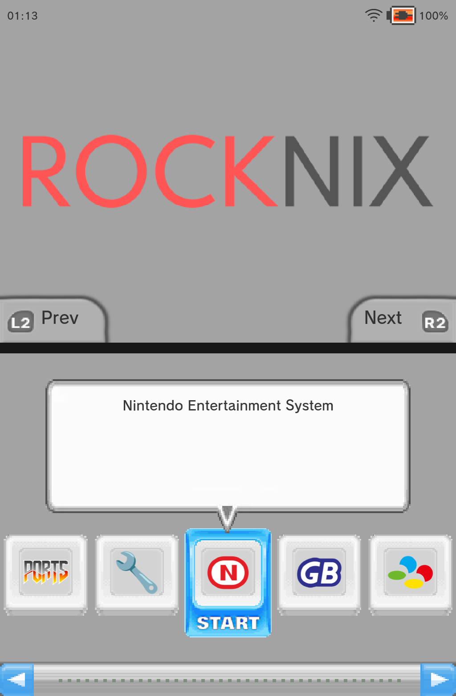
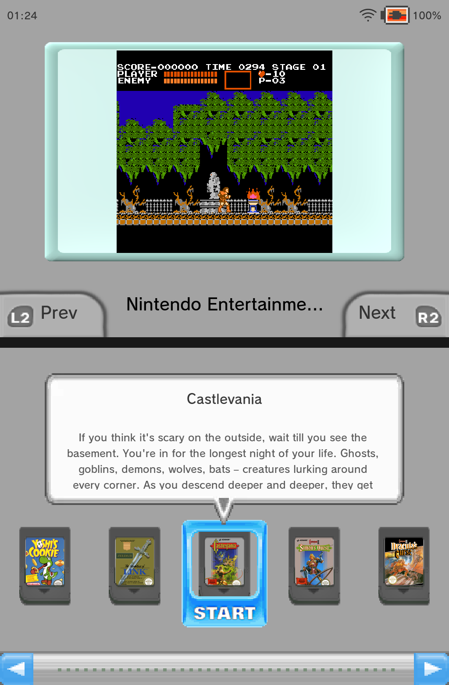
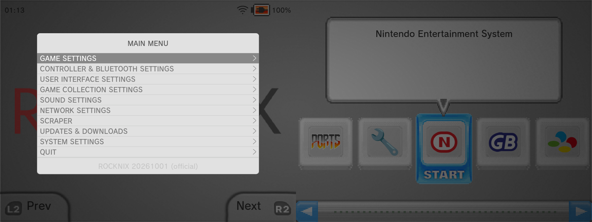
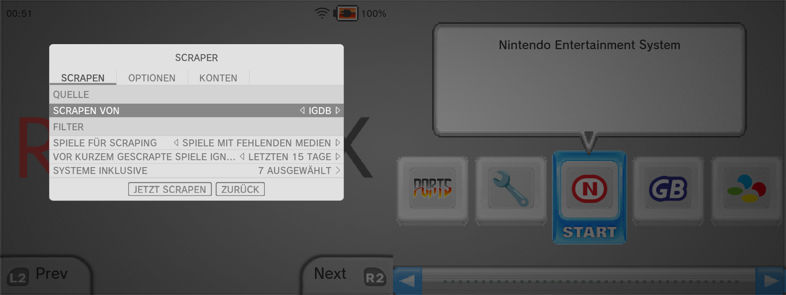
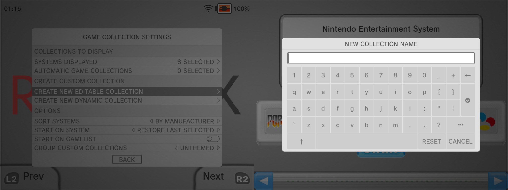
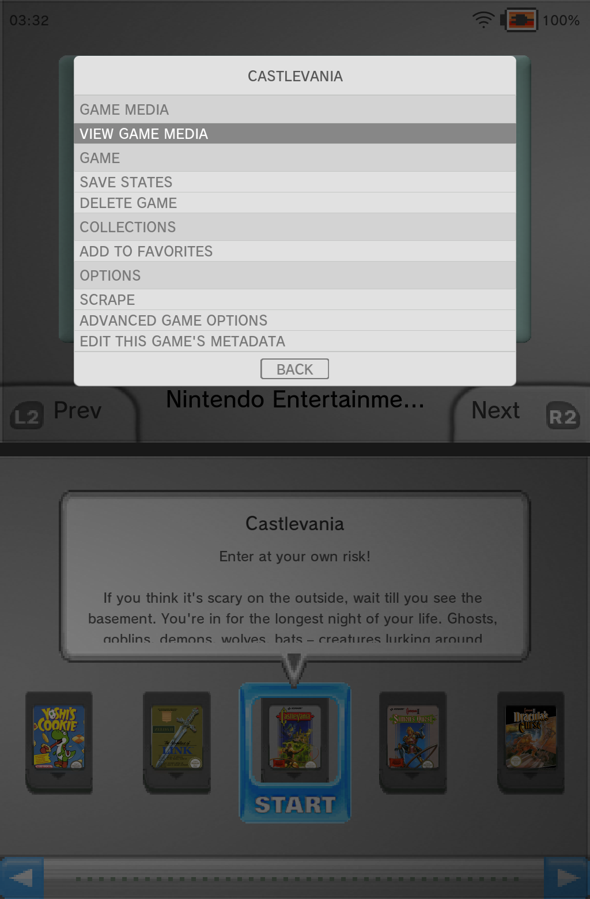

# ROCKNIX DualStation – Anleitung (Deutsch)

**Dual-Screen-EmulationStation für ROCKNIX** – Anbernic RG DS Plus (Unterstützung für das RG DS ist in Arbeit).
*Früher „dii-ess-aye-rocknix-dual mod“.*

🇬🇧 [English version](README.md)

Dual-Screen-EmulationStation für das **Anbernic RG DS Plus** unter
**ROCKNIX** (RK3566). EmulationStation läuft über beide Bildschirme
(2048 × 768): oben das ROCKNIX-Logo, unten die Systemansicht. Menüs und
Meldungen erscheinen sauber auf dem oberen Screen.



*Linke Hälfte: oberer Screen · rechte Hälfte: unterer Screen (2048 × 768).*

Gedacht für **dii-ess-aye-rgds-plus**, meine Anpassung von
[dii-ess-aye](https://github.com/beebono/dii-ess-aye) für das RG DS Plus.
Das Original-Theme für das RG DS stammt von beebono.

> **Zum Theme:** dii-ess-aye steht unter der MIT-Lizenz von beebono, der
> die Weitergabe der RG-DS-Plus-Variante freundlicherweise erlaubt hat. Die
> Variante liegt in [`theme/dii-ess-aye-rgds-plus/`](theme/dii-ess-aye-rgds-plus/),
> zusammen mit der Original-Lizenz und dem Copyright-Vermerk.

**Ebenfalls unterstützt:** [canvas-ds](https://github.com/toniremi/canvas-ds) von toniremi,
über ein kleines Overlay in [`theme/canvas-ds-rgds-plus-overlay/`](theme/canvas-ds-rgds-plus-overlay/)
(mit seiner Erlaubnis, CC BY-NC-SA). Der Ports-Umschalter merkt sich, welches
Theme du in welchem Modus nutzt.

---

## Was funktioniert

- Hauptansicht über beide Screens, Navigation zwischen den Systemen
- Rückkehr aus RetroArch und anderen Emulatoren, ohne dass der untere Screen ausgeht
- Scraper, Updates, Downloads, Themes und Info-Meldungen auf dem oberen Screen
- Save State Manager, Advanced Game Settings, Bildschirmtastatur, The Bezel Project
- Umschalten zwischen dieser Version und dem Original-ES über **Ports**, inklusive Theme-Wechsel
- Übersteht Neustarts des Geräts

## Screenshots

| | |
|---|---|
|  |  |
| **Spieleliste** – Vorschau oben, Spiele-Karussell und Beschreibung unten | **Hauptmenü** auf dem oberen Screen |
|  |  |
| **Scraper-Menü** auf dem oberen Screen | **Bildschirmtastatur** unten, Einstellungen oben |
|  | |
| **Spieloptionen** oben, die Spieleliste bleibt unten sichtbar | |

### canvas-ds

| | |
|---|---|
|  |  |
| **Systemansicht** mit dem [canvas-ds](https://github.com/toniremi/canvas-ds)-Overlay | **Spieleliste „Detailed“** mit canvas-ds |

## Behobene Probleme mit dii-ess-aye auf dem RG DS Plus

Das sind keine Fehler im Theme selbst. Sie entstehen dadurch, wie das
Original-ES und die Sway-Regeln von ROCKNIX mit einem Fenster von
2048 × 768 umgehen. Dieser Mod behebt sie in EmulationStation und in der
Sway-Einrichtung, damit das Theme wie gedacht funktioniert:

| Problem mit Original-ES / ROCKNIX | Behoben durch |
|---|---|
| Unterer Screen nach der Rückkehr aus einem Spiel aus, alles landet oben | Sway-Regeln (`rgds-sway-fix.sh`) |
| Navigation zwischen den Systemen in der Hauptansicht funktionierte nicht | Sway: globales Vollbild über beide Ausgänge |
| ES-Fenster schrumpfte nach einem Spiel oder Neustart auf einen Screen (1024 × 768) | Sway: globales Vollbild über beide Ausgänge |
| Korrekturen gingen bei jedem Neustart verloren (ROCKNIX schreibt die Sway-Config neu) | `rgds-sway-fix.sh` läuft vor jedem Start |
| Scraper-, Updates-, Downloads- und Theme-Menüs über beide Screens gezogen | ES-Patch (`RGDS_MENU_W`) |
| Info-Meldungen (z. B. „Scraping finished“) über beide Screens verteilt | ES-Patch (`GuiInfoPopup`) |
| Ladeanzeigen („Bitte warten“, WLAN-Suche, Verbinden) über beide Screens | ES-Patch (`GuiLoading` startet standardmäßig oben) |
| BIOS-Prüfung („Fehlende BIOS-Dateien“) über beide Screens verteilt | ES-Patch (`GuiBios`) |
| Spieloptionen als schmale Seitenleiste über die volle Höhe an der Bildschirmgrenze | ES-Patch (`GuiGameOptions`: zentriertes Menü oben wie die übrigen Menüs) |
| „Metadaten dieses Spiels bearbeiten“ über beide Screens verteilt | ES-Patch (`GuiMetaDataEd`) |
| „Spielemedien ansehen“ zog Bilder und Videos über beide Screens | ES-Patch (`GuiImageViewer`: nur oberer Screen) |
| Position von Hauptmenü, Einstellungen, Save State Manager, Tastatur und Bezel Project | ES-Patch (frühere Dual-Screen-Arbeit) |
| Original-ES zeigt beide Theme-Hälften gequetscht auf dem oberen Screen | Ports-Umschalter setzt für das Original-ES ein Einzelbildschirm-Theme |

## Einschränkungen

- **Kein ScreenScraper und keine RetroAchievements** in dieser Version (Release
  oder selbst gebaut). Die nötigen Entwicklerzugangsdaten bekommt nur der offizielle
  ROCKNIX-Build. Zum Scrapen per Port auf **Single** wechseln, danach
  zurück auf **Dual**. Medien und Gamelists werden geteilt.
- DS-Spiele über RetroArch-Cores (melonDS/DeSmuME) sind ungetestet.
  Eigenständige Emulatoren wie DraStic oder dsperate funktionieren.
- Getestet auf ROCKNIX mit EmulationStation-Commit `cada856d86e3`.

---

## Aufbau

```
patches/                     ES-Patch für das ROCKNIX-Buildsystem
device/rgds-test/            Skripte für /storage/rgds-test/ auf dem Gerät
  start-es-v2-diag.sh        Startskript der Dual-Version
  rgds-sway-fix.sh           passt die Sway-Config vor jedem Start an
  es-switch-helper.sh        Umschalten single/dual (Theme, Dienst, Sway)
device/ports/                Einträge für /storage/roms/ports/
device/system.d/             Drop-in für essway.service
theme/dii-ess-aye-rgds-plus/ RG-DS-Plus-Variante des Themes dii-ess-aye (MIT)
theme/canvas-ds-rgds-plus-overlay/ Layout-Overlay für canvas-ds (CC BY-NC-SA)
docs/BUILD.de.md             Bauen des ES-Pakets
docs/screenshots/            Screenshots für diese README
docs/zwischenstand-*.md      technische Analyse und Projektstand
```

---

## Installation

**`dii-ess-aye-rocknix-dual-mod-v7.tar.gz`** aus dem
[aktuellen Release](https://github.com/Ninte86hl/rocknix-dualstation/releases/latest)
herunterladen und auf dem Rechner entpacken:

```bash
tar xzf dii-ess-aye-rocknix-dual-mod-v7.tar.gz
```
```bash
cd dii-ess-aye-rocknix-dual-mod-v7
```

Das Paket enthält die fertige ES-Binärdatei `emulationstation-rgds-v7`.
Selbst bauen ist optional (siehe [`docs/BUILD.de.md`](docs/BUILD.de.md)); eine
selbst gebaute Datei muss ebenfalls mit `emulationstation-rgds` beginnen.

`<IP>` durch die IP-Adresse des Geräts ersetzen.

**1. Ordner auf dem Gerät anlegen:**
```bash
ssh root@<IP> mkdir -p /storage/rgds-test /storage/.config/system.d/essway.service.d
```

**2. Dateien übertragen (aus dem entpackten Ordner):**
```bash
scp emulationstation-rgds-v7 device/rgds-test/*.sh root@<IP>:/storage/rgds-test/
```
```bash
scp device/ports/*.sh root@<IP>:/storage/roms/ports/
```
```bash
scp device/system.d/essway.service.d/rgds.conf root@<IP>:/storage/.config/system.d/essway.service.d/
```
```bash
scp -r theme/dii-ess-aye-rgds-plus root@<IP>:/storage/.config/emulationstation/themes/
```

**3. Auf dem Gerät ausführbar machen und aktivieren:**
```bash
chmod +x /storage/rgds-test/* /storage/roms/ports/RGDS*.sh
```
```bash
systemctl daemon-reload
```
```bash
/storage/rgds-test/es-switch-helper.sh dual
```

Der Wechsel auf **dual** setzt dabei auch das Theme *dii-ess-aye-rgds-plus*.
Danach in ES unter **Ports** die Einträge *RGDS Dual-Screen ES* und
*RGDS Single-Screen ES* nutzen. Falls sie fehlen: Spielelisten aktualisieren.

## Deinstallation

Per Port auf **Single** wechseln. Das entfernt den Drop-in und stellt das
Original-ES wieder her. Danach können `/storage/rgds-test/` und die beiden
Port-Skripte gelöscht werden.

---

## Wie es funktioniert

### Sway

ROCKNIX schreibt `/storage/.config/sway/config` bei jedem Boot neu
(`/usr/lib/autostart/common/111-sway-init`). Die Original-Regeln laden bei
jedem neuen ES-Fenster die Config neu und schalten dabei den unteren Screen
aus. Sway-Kriterien sind unverankerte reguläre Ausdrücke,
`[app_id="emulationstation"]` trifft also auch diese Version.

`rgds-sway-fix.sh` ergänzt deshalb vor jedem Start:

```text
for_window [app_id="^emulationstation-rgds"] fullscreen enable global
exec_always swaymsg '[app_id="emulationstation"]' focus output DSI-2, output DSI-1 power on
```

### EmulationStation

Bei 2048 × 768 werden Menüs auf 1024 Pixel Breite zentriert und liegen
damit auf dem oberen Screen:

```cpp
#define RGDS_MENU_W ((Renderer::getScreenWidth() == 2048 && Renderer::getScreenHeight() == 768) ? 1024.0f : (float)Renderer::getScreenWidth())
```

Ladeanzeigen (`GuiLoading`) erscheinen standardmäßig auf dem oberen Screen;
The Bezel Project legt seine Ladeanzeige mit `setLoadingArea()` nach unten.

### Umschalten

Port-Skripte laufen innerhalb von `essway`. Ein direkter Neustart des
Dienstes würde sie mit beenden. Sie starten deshalb `es-switch-helper.sh`
über `systemd-run`. Das Hilfsskript stoppt ES, setzt `ThemeSet` in
`es_settings.cfg`, setzt oder entfernt den Drop-in und startet ES neu.
Protokoll: `/storage/rgds-test/es-switch.log`.

---

## Danksagung

Dieses Projekt baut auf der Arbeit der ROCKNIX- und Batocera-Teams, dem
ursprünglichen EmulationStation sowie den Themes dii-ess-aye von beebono und canvas-ds von toniremi auf.
Die vollständige Liste steht in [`CREDITS.md`](CREDITS.md). Vielen Dank! 🙏

## Lizenz

Skripte und Dokumentation: MIT (siehe [`LICENSE`](LICENSE)).
Der Patch ändert [ROCKNIX/emulationstation-next](https://github.com/ROCKNIX/emulationstation-next),
das ebenfalls unter der MIT-Lizenz steht; die Urheberrechtsvermerke bleiben
bei den ursprünglichen Autoren. Das Theme steht unter der MIT-Lizenz von beebono (siehe `CREDITS.md`).
Auf Screenshots sichtbare Logos und Grafiken gehören ihren jeweiligen Eigentümern.
