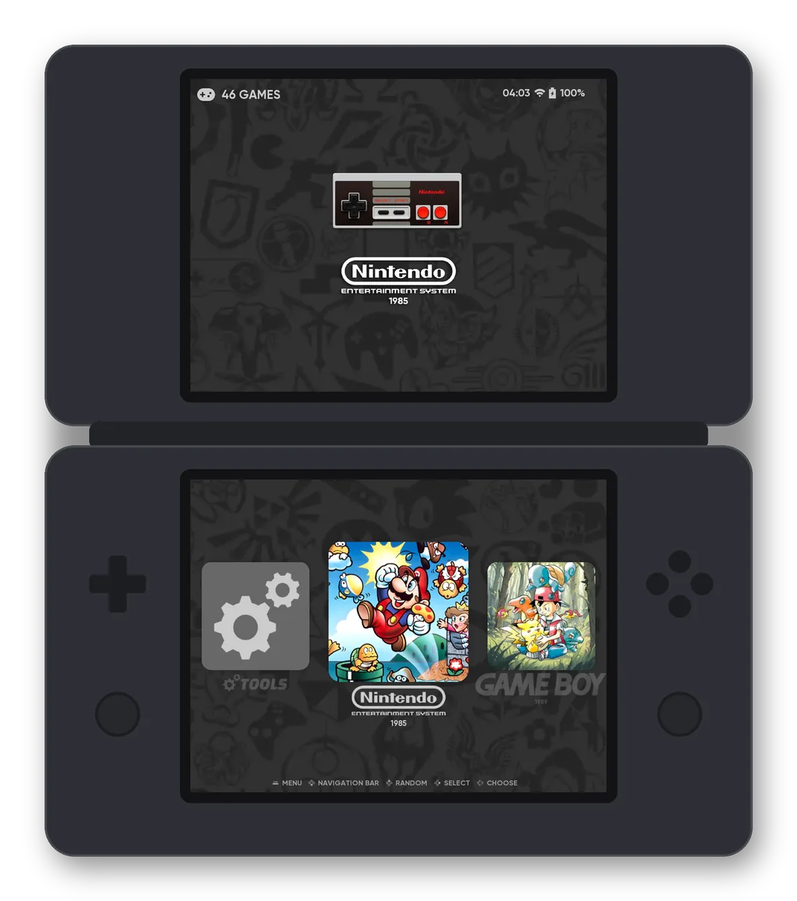
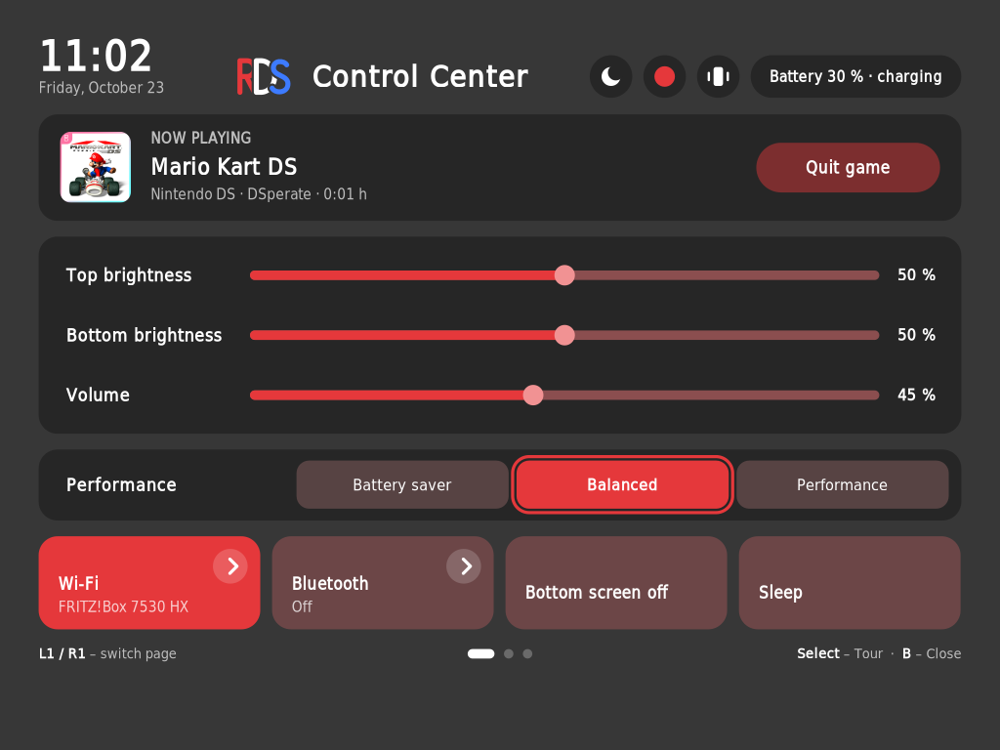
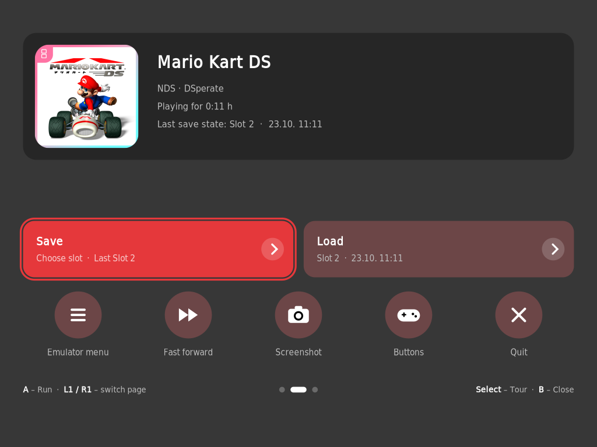
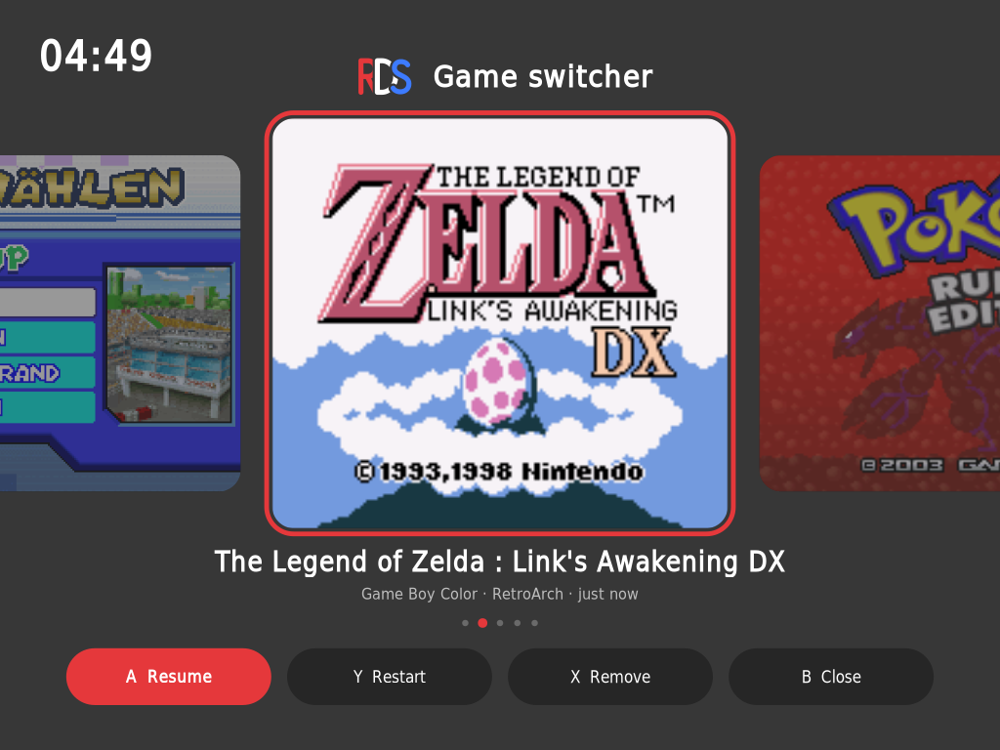
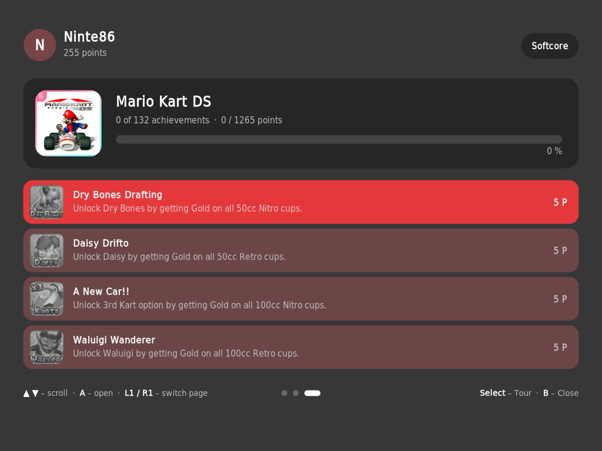
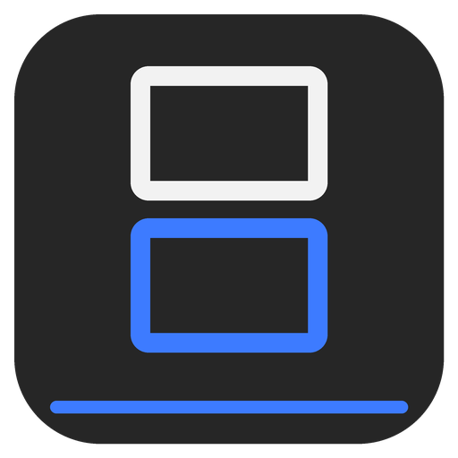
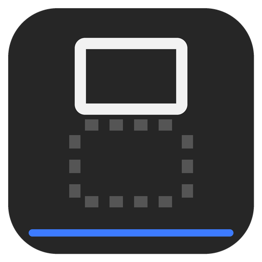

# RetroDualStation

**One system, two screens, everything in sync.**

Dual-Screen-EmulationStation für das **Anbernic RG DS Plus** und **RG DS**, aufgebaut auf **ROCKNIX**.
*Früher „ROCKNIX DualStation“.*

🇬🇧 [English version](README.md) · 🧭 [Kurze Tour](https://github.com/Ninte86hl/RetroDualStation/wiki/Tour-DE)

<p align="center"></p>

---

## Was ist RetroDualStation?

ROCKNIX zeigt EmulationStation auf dem RG DS Plus und RG DS normalerweise auf einem Bildschirm.
RetroDualStation nutzt **beide Bildschirme**: oben Artwork und Video,
Spieleliste und Menüs dort, wo sie hingehören – auch nach Spielen und Neustarts.
Ein freies Add-on: Installation über **Ports**, zurück zum Original-ES mit einem Tipp.

## Galerie

*Zum Umschalten auf einen Titel tippen.*

<details open>
<summary><b>Kontrollcenter</b></summary>

<p align="center"> </p>

**Anbernic-Taste** – Schnelleinstellungen, Speicherplätze mit Bild, Vorspulen, Power-Menü – über jedem Spiel. → [mehr](https://github.com/Ninte86hl/RetroDualStation/wiki/Kontrollcenter)

</details>

<details>
<summary><b>Gameswitcher</b></summary>

<p align="center"></p>

**Home halten** – zwischen den letzten Spielen wechseln und genau dort weitermachen. Ein Wechsel dauert etwa 5 Sekunden: Jedes Spiel wird wie gewohnt über ES gestartet, der Emulator lädt also jedes Mal neu. → [mehr](https://github.com/Ninte86hl/RetroDualStation/wiki/Gameswitcher)

</details>

<details>
<summary><b>RetroAchievements</b></summary>

<p align="center"></p>

Fortschritt und alle Erfolge im Kontrollcenter, Meldung oben über dem Spiel. → [mehr](https://github.com/Ninte86hl/RetroDualStation/wiki/RetroAchievements-DE)

</details>

🧭 **Neu hier? Die [kurze Tour](https://github.com/Ninte86hl/RetroDualStation/wiki/Tour-DE) zeigt alle Tasten und Funktionen in wenigen Minuten.**

📖 Alle Funktionen, Tasten und Tipps: **[Wiki](https://github.com/Ninte86hl/RetroDualStation/wiki/Home-DE)** · [Roadmap](https://github.com/Ninte86hl/RetroDualStation/wiki/Roadmap-DE) · [Gut zu wissen](https://github.com/Ninte86hl/RetroDualStation/wiki/Gut-zu-wissen)

## Was ist anders?

| | ROCKNIX Standard | RetroDualStation |
|---|---|---|
| EmulationStation | ein Bildschirm | **beide Bildschirme** |
| Themes | ein Bildschirm | Dual-Screen-Themes wie **[canvas-ds](https://github.com/Ninte86hl/RetroDualStation/wiki/Themes-DE)** |
| Artwork | Scraper-Bilder | Boxart, Icon und Hero pro Spiel über den **Artwork Manager** – direkt am Gerät |
| Unterer Bildschirm im Spiel | nur RetroArch-Touchmenü | **Kontrollcenter** überall – ES, RetroArch, DraStic, DSperate, PortMaster |
| Zurück zum Original | – | ein Tipp unter **Ports** |

## Installation

1. **`retrodualstation-v15.1.zip`** (enthält canvas-ds) aus dem [aktuellen Release](https://github.com/Ninte86hl/RetroDualStation/releases/latest) laden.
2. In den Ordner **`ports`** bei den ROMs entpacken (`/storage/roms/ports`).
3. In ES **Ports** →  **Install RDS** starten.

Der Installer prüft vorher Gerät und ROCKNIX-Version und verändert nichts, wenn sie nicht passen.
Ein Update funktioniert genauso. Danach stehen unter **Ports**:

| | Eintrag | Wofür |
|:-:|---|---|
|  | **Install RDS** | Installiert oder aktualisiert RDS |
|  | **RDS Dual-Screen** | ES über beide Bildschirme |
|  | **RDS Single-Screen** | Original-ES auf einem Bildschirm |
|  | **Artwork Manager** | Boxart, Icon und Hero am Gerät |
|  | **Uninstall RDS** | Zurück zum Original, Spiele und Spielstände bleiben |

<details>
<summary>ROMs auf einer ext4-Partition? ZIP über das Netzwerk kopieren</summary>

```bash
scp retrodualstation-v15.1.zip root@<IP>:/storage/roms/ports/
```
```bash
ssh root@<IP> "cd /storage/roms/ports && unzip retrodualstation-v15.1.zip && rm retrodualstation-v15.1.zip"
```
</details>

Technik und manuelle Installation: [docs/TECHNIK.md](docs/TECHNIK.md)

## Wie RDS entsteht

RetroDualStation ist ein **Hobbyprojekt**. Ich bin kein professioneller Entwickler – ohne die Hilfe von KI
(Claude von Anthropic) hätte ich es nicht umsetzen können. Der Code ist größtenteils mit ihrer Hilfe
entstanden, und das möchte ich offen sagen.

**Alle Designs, Ideen und Entscheidungen stammen von mir** – auch Aussehen und Bedienung von Kontrollcenter,
Gameswitcher und Power-Menü – und jede Funktion habe ich vor dem Release **selbst auf echten Geräten getestet**
(RG DS und RG DS Plus). Rückmeldungen, Fehlerberichte und Ideen sind als
[Issues](https://github.com/Ninte86hl/RetroDualStation/issues) herzlich willkommen.

## Danksagung & Lizenz

Ein besonderer Dank geht an die beiden Theme-Ersteller, ohne die RDS nicht so aussähe:

- **[beebono](https://github.com/beebono)** mit [dii-ess-aye](https://github.com/beebono/dii-ess-aye) – das Dual-Screen-Theme für das RG DS, mit dem RDS begann. Bei uns als **dii-ess-aye rds**.
- **[toniremi](https://github.com/toniremi)** mit [canvas-ds](https://github.com/toniremi/canvas-ds) – das Standard-Theme von RDS mit fünf Ansichten, Hero-Bild und Video. Bei uns als **canvas rds**, mit seiner Erlaubnis geteilt.

Beide Themes tragen bewusst ihre Namen weiter. Danke euch! 🙏

Aufgebaut außerdem auf der Arbeit der ROCKNIX- und Batocera-Teams und dem ursprünglichen EmulationStation.
Vollständige Liste: [CREDITS.md](CREDITS.md).

Skripte und Dokumentation: MIT ([LICENSE](LICENSE)). Der ES-Patch ändert
[ROCKNIX/emulationstation-next](https://github.com/ROCKNIX/emulationstation-next) (MIT).
Auf Screenshots sichtbare Logos und Grafiken gehören ihren jeweiligen Eigentümern.
