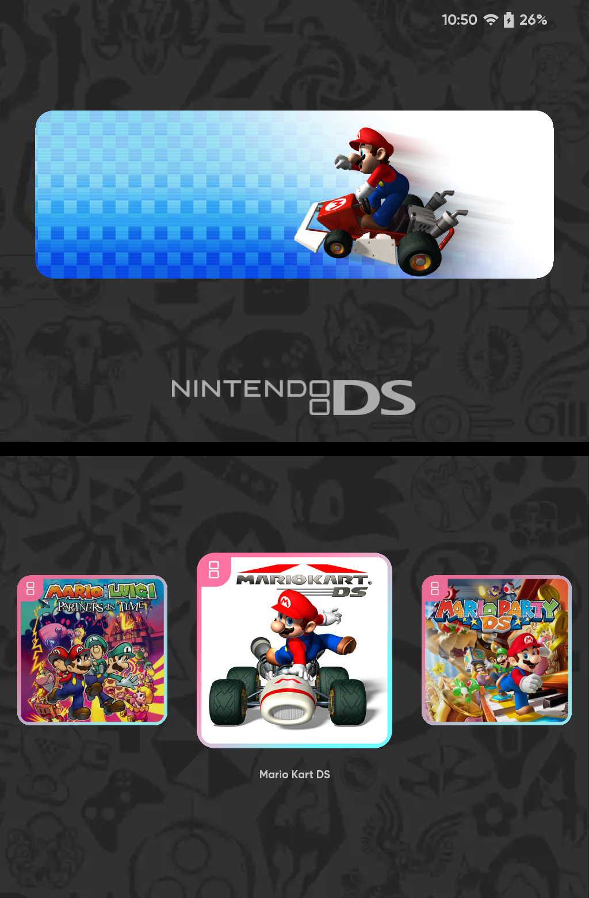
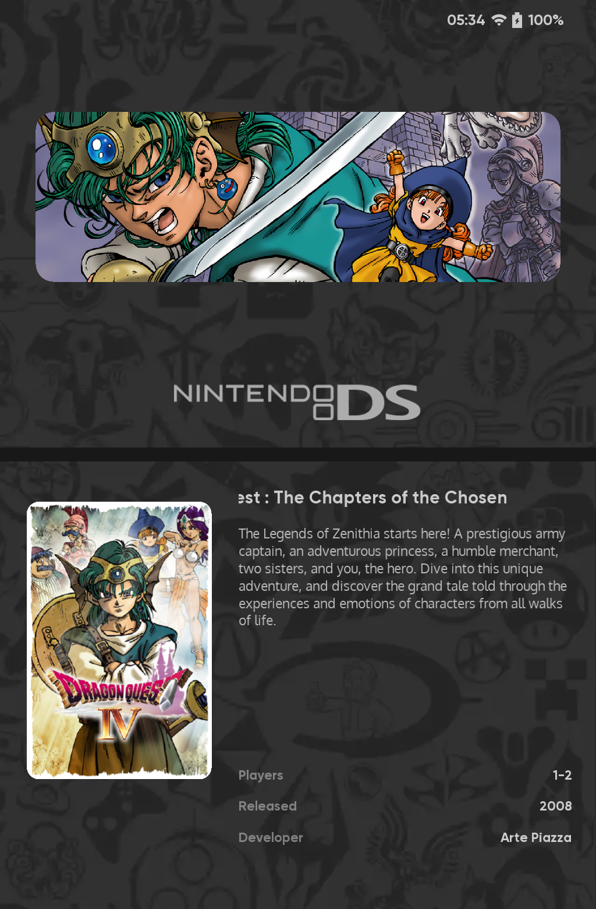
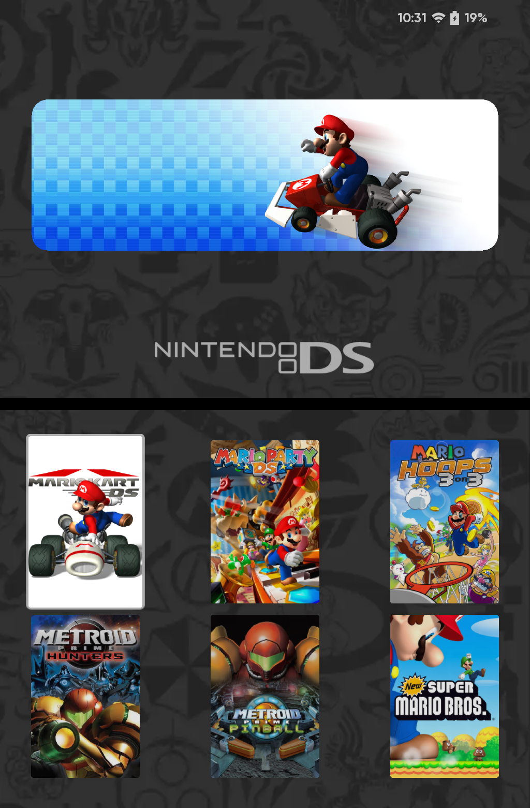
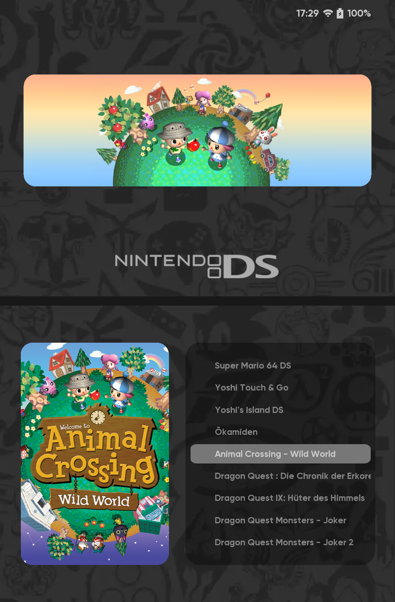
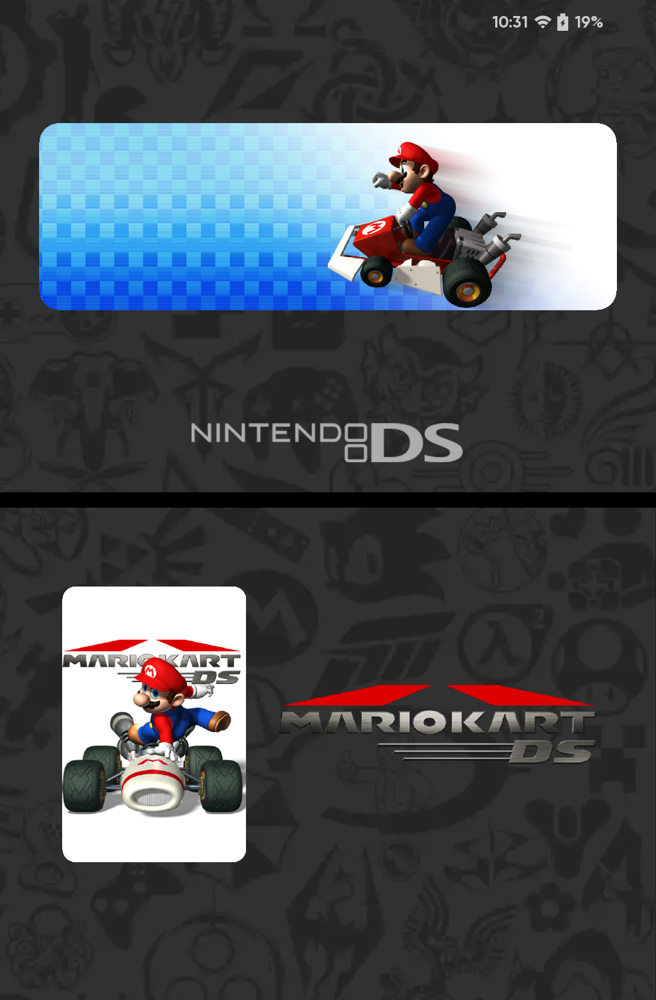
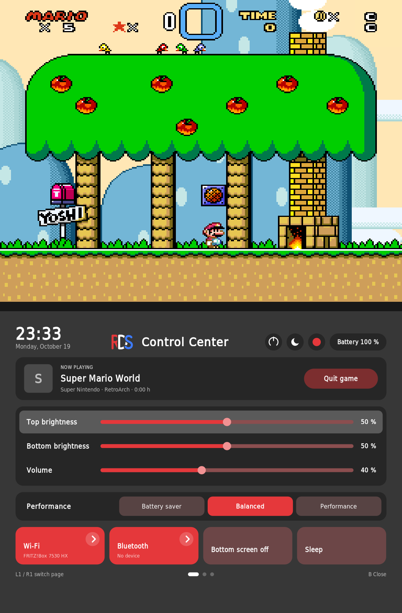
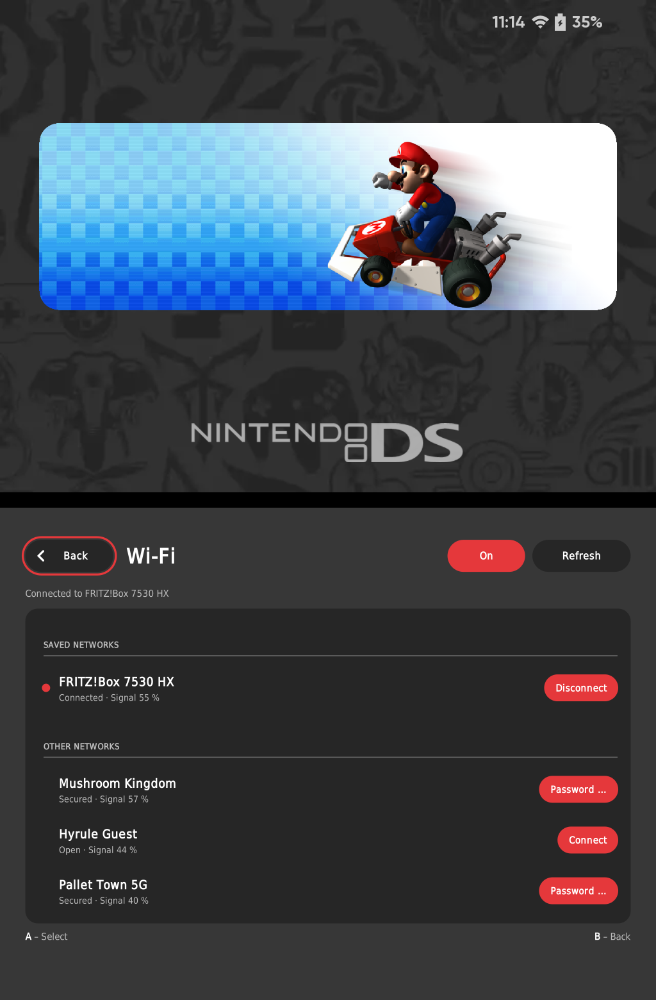
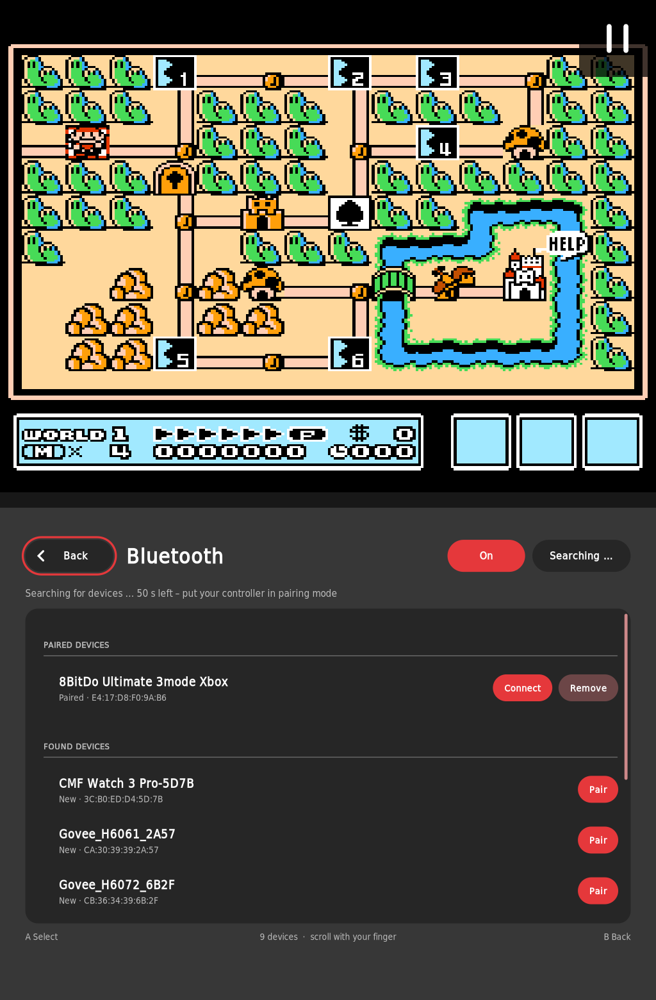
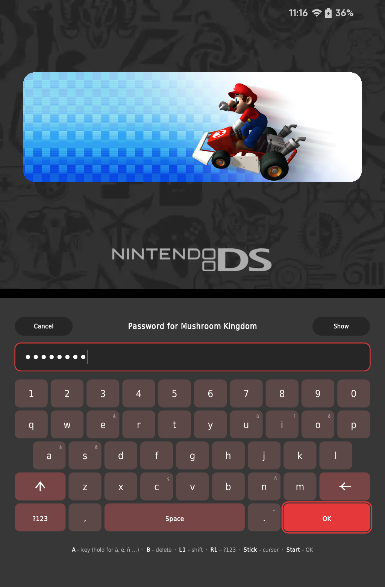
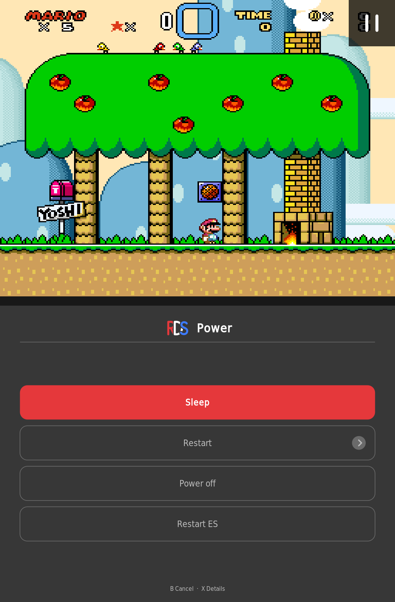

# RetroDualStation

**One system, two screens, everything in sync.**

Dual-screen EmulationStation for the **Anbernic RG DS Plus**, built on **ROCKNIX**.
*Formerly “ROCKNIX DualStation”.*

🇩🇪 [Deutsche Version](README.de.md)


---

## What is RetroDualStation?

Stock ROCKNIX runs EmulationStation on one screen of the RG DS Plus.
RetroDualStation stretches it across **both screens** (2048 × 768): artwork and video on top,
your game list and menus where they belong – and it stays that way after games and reboots.
It is a free, open add-on: install it via **Ports**, switch back to stock ES with one tap.

## What's different?

| | Stock ROCKNIX | RetroDualStation |
|---|---|---|
| EmulationStation | one screen | **both screens** |
| Themes | single-screen | dual-screen themes like **canvas-ds** |
| Artwork | scraper images | hero, icon and cover per game via **DualStation Sync** |
| Bottom screen in games | RetroArch touch menu only | **Control Center** everywhere – ES, RetroArch, DraStic, DSperate, PortMaster |
| Going back | – | one tap in **Ports** |

## What we offer

- **Dual-screen ES** – menus, scraper, keyboard and popups placed on the right screen
- **canvas-ds** – five game list views made for two screens
- **DualStation Sync** – desktop companion that prepares dual-screen artwork *(see below)*
- **Control Center** – quick settings, power menu and quit game over any game

## Themes

### canvas-ds

[canvas-ds](https://github.com/toniremi/canvas-ds) by toniremi, adapted with a small overlay
(shared with his permission, CC BY-NC-SA). Top screen: hero image, the video fades in after 5 seconds.

| | |
|---|---|
|  |  |
| **Gamecarousel** – icons side by side | **Detailed** – cover, description and info |
|  |  |
| **Grid** – covers fill the bottom screen | **Showcase** – cover and game list |
|  | |
| **Spotlight** – one large card that slides in | |

Artwork: `romname-hero.png`, `romname-icon.png`, `romname-box.png` and the scraper logo –
DualStation Sync creates the first three for you; missing images fall back to scraper media.

## DualStation Sync

Our desktop companion (currently published as
[RocknixDS Artwork Manager](https://github.com/Ninte86hl/RocknixDS-Artwork-Manager)):
prepares hero, icon and cover images for your games in the names and sizes canvas-ds expects.

## Control Center

The **Anbernic button** opens a control center on the bottom screen – over ES, RetroArch, DraStic,
DSperate and PortMaster. The game pauses and continues where you left off.

- **Quick settings** – brightness for both screens, volume, performance, Wi-Fi, Bluetooth
- **Quit game** – no more shortcuts to remember
- **Bottom screen off** – play DS games on one screen; the Anbernic button turns it back on.
  In RetroArch and PortMaster the bottom screen goes dark automatically.
- **Power menu** – a short press on the **power button**: sleep, restart (optionally saving logs),
  power off, restart ES
- English or German, following the ES language

| | |
|---|---|
|  |  |
| **Control Center** over a paused game | **Wi-Fi** – saved networks on top |
|  |  |
| **Bluetooth** – pair controllers directly | **On-screen keyboard** for passwords |
|  | |
| **Power menu** – short press on the power button | |

## Roadmap

| Status | What |
|---|---|
| ✅ | Dual-screen EmulationStation, installer, one-tap switch back |
| ✅ | canvas-ds with five game list views |
| ✅ | DualStation Sync: dual-screen artwork |
| ✅ | Control Center: quick settings, Wi-Fi, Bluetooth, keyboard, power menu, quit game, bottom screen off |
| 🔜 **next** | Game switcher – recent games with a screenshot of where you left off; **A** resume, **Y** start fresh |
| 🔜 | Control Center: game page – save states and shortcuts |
| 🔜 | Support for the original RG DS |
| 💭 maybe | Settings menu like on a smartphone, opened from the Control Center |
| 💭 maybe | RetroAchievements – unlock notification and overview |
| 💭 maybe | User profiles with their own saves |
| 🕓 later | DualStation Sync: better title matching, editing game lists |

## Installation

1. Download **`rocknix-dualstation-v10.zip`** (includes canvas-ds) from the
   [latest release](https://github.com/Ninte86hl/rocknix-dualstation/releases/latest).
2. Unpack it into the **`ports`** folder of your ROMs (`/storage/roms/ports`).
3. In ES open **Ports** → **Install ROCKNIX DualStation**.

The installer checks your device and ROCKNIX version first and changes nothing if they don't match.
Afterwards **Ports** has *RGDS Dual-Screen ES*, *RGDS Single-Screen ES* and *Uninstall*.
Updating works the same way.

<details>
<summary>ROMs on an ext4 partition? Copy the ZIP over the network</summary>

```bash
scp rocknix-dualstation-v10.zip root@<IP>:/storage/roms/ports/
```
```bash
ssh root@<IP> "cd /storage/roms/ports && unzip rocknix-dualstation-v10.zip && rm rocknix-dualstation-v10.zip"
```
</details>

**Uninstall:** *Ports → Uninstall ROCKNIX DualStation* restores stock ES and its theme.
Games, media, game lists and saves are not touched.

## Good to know

- **No ScreenScraper and no RetroAchievements** in the dual-screen build – the credentials are
  reserved for the official ROCKNIX build. To scrape, switch to *Single* via Ports and back.
- DS via RetroArch cores is untested; DraStic and DSperate work.
- DraStic touch not responding? Set **Follow 3D Renderer** to *Auto* (also happens on stock ROCKNIX).

Technical details, manual installation and how it works: [docs/TECHNICAL.md](docs/TECHNICAL.md)

## Credits & license

Built on the work of the ROCKNIX and Batocera teams, the original EmulationStation,
toniremi's canvas-ds and beebono's dii-ess-aye. Full list: [CREDITS.md](CREDITS.md). Thank you! 🙏

Scripts and documentation: MIT ([LICENSE](LICENSE)). The ES patch modifies
[ROCKNIX/emulationstation-next](https://github.com/ROCKNIX/emulationstation-next) (MIT).
Logos and artwork in screenshots belong to their respective owners.
