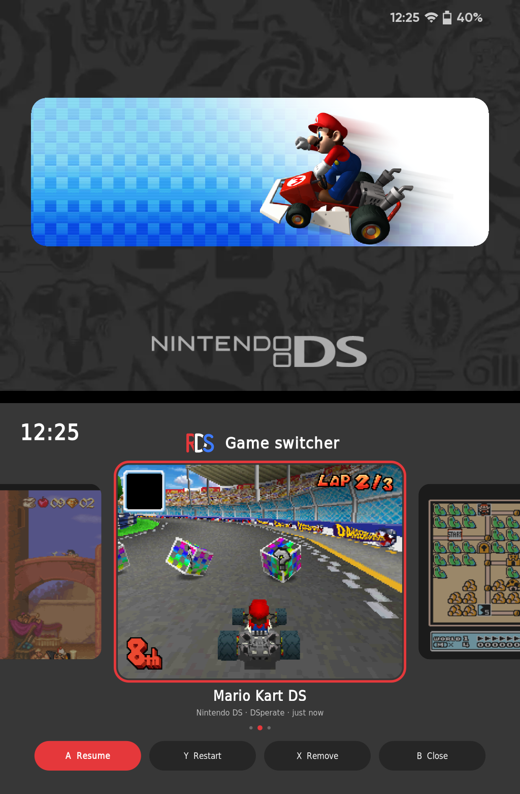

# RetroDualStation

**One system, two screens, everything in sync.**

Dual-screen EmulationStation for the **Anbernic RG DS Plus**, built on **ROCKNIX**.
*Formerly “ROCKNIX DualStation”.*

🇩🇪 [Deutsche Version](README.de.md) · 🧭 [Quick tour](docs/TOUR.md)

<p align="center"></p>

---

## What is RetroDualStation?

Stock ROCKNIX runs EmulationStation on one screen of the RG DS Plus.
RetroDualStation stretches it across **both screens** (2048 × 768): artwork and video on top,
your game list and menus where they belong – and it stays that way after games and reboots.
It is a free, open add-on: install it via **Ports**, switch back to stock ES with one tap.

## What's different?

| | Stock ROCKNIX | RetroDualStation |
|---|---|---|
| EmulationStation | one screen | **both screens** |
| Themes | single-screen | dual-screen themes like **canvas-ds** |
| Artwork | scraper images | boxart, icon and hero per game via the **Artwork Manager** – right on the device |
| Bottom screen in games | RetroArch touch menu only | **Control Center** everywhere – ES, RetroArch, DraStic, DSperate, PortMaster |
| Going back | – | one tap in **Ports** |

## What we offer

- **Dual-screen ES** – menus, scraper, keyboard and popups placed on the right screen
- **canvas-ds** – five game list views made for two screens
- **Artwork Manager** – find and fit artwork for your games on the device itself *(see below)*
- **Control Center** – quick settings, power menu and quit game over any game
- **Game switcher** – jump between your recent games and continue where you left off
- **Game search** – press **Y** in the system view to search all systems at once
- **Quick tour** – runs once after installing, again any time with **Select** in the Control Center

## Themes

### canvas-ds

[canvas-ds](https://github.com/toniremi/canvas-ds) by toniremi, adapted with a small overlay
(shared with his permission, CC BY-NC-SA). Top screen: hero image, the video fades in after 5 seconds.

| | | |
|:-:|:-:|:-:|
|  |  |  |
| **Gamecarousel** – icons side by side | **Detailed** – cover, description and info | **Grid** – covers fill the bottom screen |
|  |  |  |
| **Showcase** – cover and game list | **Spotlight** – one large card that slides in |  |

Artwork: `romname-hero.png`, `romname-icon.png`, `romname-box.png` and the scraper logo –
the Artwork Manager creates the first three for you; missing images fall back to scraper media.

## Artwork Manager

Start it from **Ports → Artwork Manager**. It fills in **boxart**, **cartridge icon** (1:1) and
**hero image** for your games – the top screen shows a live preview of how they look together,
the bottom screen holds lists, search and buttons.

- Sources: iiSU database and SteamGridDB (free API key in the settings), plus **your own images**
  from `ports/artworkmanager/eigene/`
- **Single search** (Start) or **batch** (Select) through all games with missing artwork
- **Icon editor** – turns any icon into a 1:1 image with the iiSU border (move, zoom, choose border)
- **Filter** in the game list: all · missing · no artwork; **game search** across all systems
- **Multi-disc games** merged into one `.m3u` entry (settings), arcade names from the FBNeo list
- A backup of each `gamelist.xml` before the first save, restore in the settings

Requirement: each system needs a `gamelist.xml` – create it once with the scraper in single-screen mode.
All buttons: [quick tour](docs/TOUR.md#5-artwork-manager).

The PC version stays available as
[RocknixDS Artwork Manager](https://github.com/Ninte86hl/RocknixDS-Artwork-Manager).

## Control Center

The **Anbernic button** opens a control center on the bottom screen – over ES, RetroArch, DraStic,
DSperate and PortMaster. The game pauses and continues where you left off.

- **Quick settings** – brightness for both screens, volume, performance, Wi-Fi, Bluetooth
- **Quit game** – no more shortcuts to remember
- **Bottom screen off** – play DS games on one screen; the Anbernic button turns it back on.
  In RetroArch and PortMaster the bottom screen goes dark automatically.
- **Power menu** – a short press on the **power button**: sleep, restart (optionally saving logs),
  power off, restart ES
- English or German, following the ES language

| | | |
|:-:|:-:|:-:|
|  |  |  |
| **Control Center** over a paused game | **Wi-Fi** – saved networks on top | **Bluetooth** – pair controllers directly |
|  |  |  |
| **On-screen keyboard** for passwords | **Power menu** – short press on the power button |  |

## Game switcher

**Hold the Home button** (1.5 s) to see your recently played games – each with a picture of where
you left off, in the shape of its console. **A** resumes exactly there, **Y** starts fresh,
**X** removes it from the list. A **short press** saves and takes you back to ES.

Works with RetroArch, DraStic, DSperate and PortMaster. Switching takes about 5 seconds –
a loading screen covers both screens and the sound stays muted until you're back in the game.

<p align="center"></p>

## Roadmap

| Status | What |
|---|---|
| ✅ | Dual-screen EmulationStation, installer, one-tap switch back |
| ✅ | canvas-ds with five game list views |
| ✅ | Artwork Manager on the device – boxart, icon, hero, icon editor, M3U *(in v12)* |
| ✅ | Control Center: quick settings, Wi-Fi, Bluetooth, keyboard, power menu, quit game, bottom screen off |
| ✅ | Game switcher – recent games with a screenshot of where you left off; **A** resume, **Y** start fresh *(in v11)* |
| ✅ | Game search with **Y** in the system view, quick tour *(in v12)* |
| 🔜 **next** | Control Center: game page – save states and shortcuts |
| 🔜 | Support for the original RG DS |
| 💭 maybe | Settings menu like on a smartphone, opened from the Control Center |
| 💭 maybe | RetroAchievements – unlock notification and overview |
| 💭 maybe | User profiles with their own saves |
| 🕓 later | Artwork Manager: editing game lists, M3U in subfolders |

## Installation

1. Download **`rocknix-dualstation-v12.zip`** (includes canvas-ds) from the
   [latest release](https://github.com/Ninte86hl/rocknix-dualstation/releases/latest).
2. Unpack it into the **`ports`** folder of your ROMs (`/storage/roms/ports`).
3. In ES open **Ports** → **Install ROCKNIX DualStation**.

The installer checks your device and ROCKNIX version first and changes nothing if they don't match.
Afterwards **Ports** has *RGDS Dual-Screen ES*, *RGDS Single-Screen ES* and *Uninstall*.
Updating works the same way.

<details>
<summary>ROMs on an ext4 partition? Copy the ZIP over the network</summary>

```bash
scp rocknix-dualstation-v12.zip root@<IP>:/storage/roms/ports/
```
```bash
ssh root@<IP> "cd /storage/roms/ports && unzip rocknix-dualstation-v12.zip && rm rocknix-dualstation-v12.zip"
```
</details>

**Uninstall:** *Ports → Uninstall ROCKNIX DualStation* restores stock ES and its theme.
Games, media, game lists and saves are not touched.

## Good to know

- **No ScreenScraper and no RetroAchievements** in the dual-screen build – the credentials are
  reserved for the official ROCKNIX build. To scrape, switch to *Single* via Ports and back.
- PS1: the installer sets **pcsx_rearmed** if no working core is selected.
- DS via RetroArch cores is untested; DraStic and DSperate work.
- DraStic touch not responding? Set **Follow 3D Renderer** to *Auto* (also happens on stock ROCKNIX).

Technical details, manual installation and how it works: [docs/TECHNICAL.md](docs/TECHNICAL.md)

## Credits & license

Built on the work of the ROCKNIX and Batocera teams, the original EmulationStation,
toniremi's canvas-ds and beebono's dii-ess-aye. Full list: [CREDITS.md](CREDITS.md). Thank you! 🙏

Scripts and documentation: MIT ([LICENSE](LICENSE)). The ES patch modifies
[ROCKNIX/emulationstation-next](https://github.com/ROCKNIX/emulationstation-next) (MIT).
Logos and artwork in screenshots belong to their respective owners.
