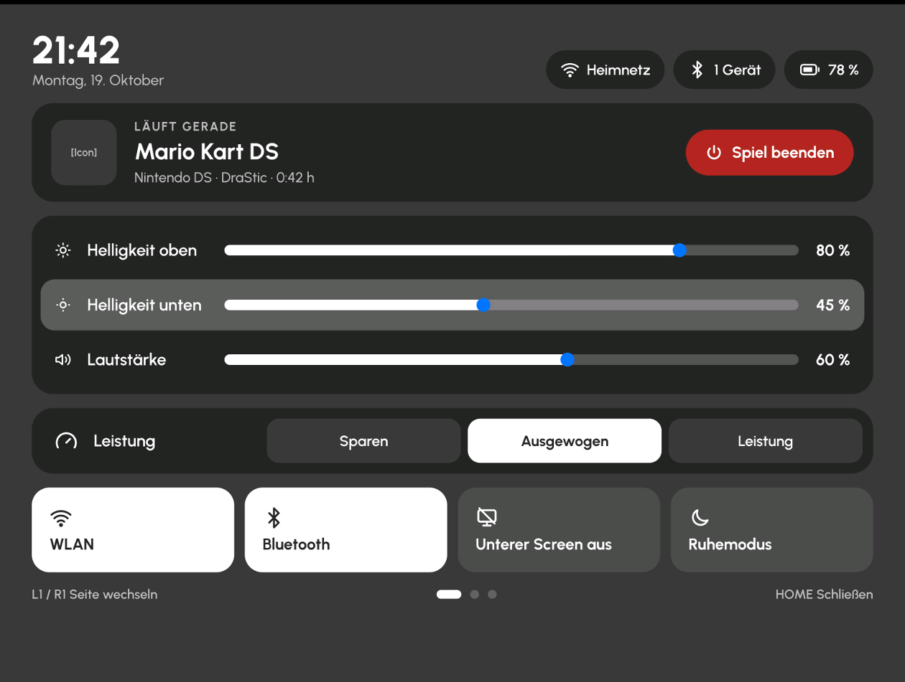
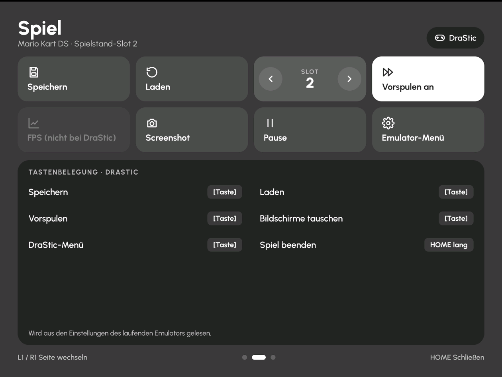
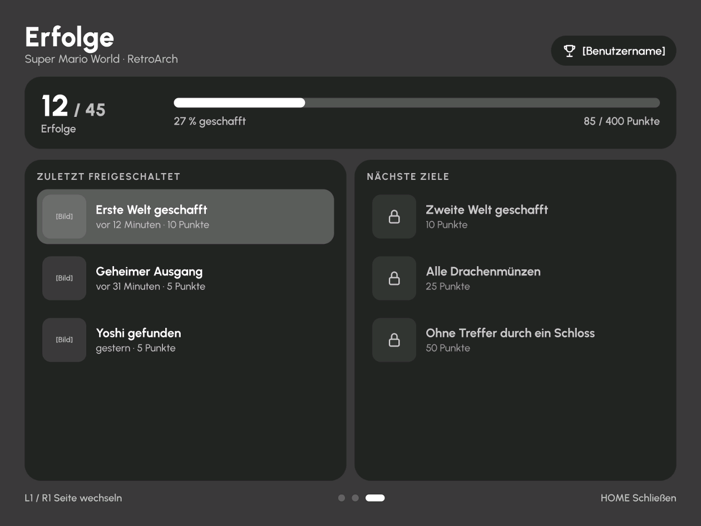
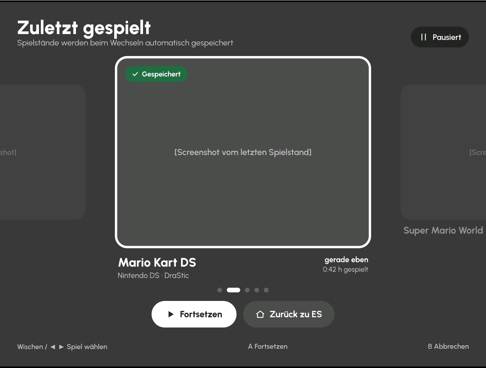

# DualStation Kontrollcenter – Plan

Stand: 19.10.2026 · Status: Planung, noch nichts gebaut

Ein eigenes Kontrollcenter für ROCKNIX DualStation, das **überall** aufrufbar ist
(EmulationStation, RetroArch, DraStic, DSperate …). Es soll DualStation ein
eigenes Alleinstellungsmerkmal geben und das Touchmenü von RetroArch auf dem
unteren Bildschirm ersetzen, damit niemand versehentlich in den
RetroArch-Einstellungen landet.

Entwurf (Mockup, drei Seiten + helle Variante): Design-Artifact
„DualStation Kontrollcenter“ in claude.ai.

## Bedienung

| Aktion | Wirkung |
|---|---|
| **Anbernic-Taste** (allein gedrückt) | Kontrollcenter auf dem **unteren Bildschirm** ein-/ausblenden |
| **Return/Home-Taste** | Gameswitcher ein-/ausblenden (Spielstand speichern, Spiel wechseln, zurück zu ES) |
| Return/Home lang | laufendes Spiel direkt beenden (ohne Switcher) |
| eine der beiden bei ausgeschaltetem unterem Bildschirm | Bildschirm wieder einschalten |

Beide Tasten gibt es am RG DS und am RG DS Plus. Die Anbernic-Taste dient in
Emulatoren auch als Hotkey-Modifikator: das Kontrollcenter öffnet sich nur,
wenn sie **allein** gedrückt und losgelassen wird; als Teil einer
Tastenkombination (z. B. Anbernic + R1) bleibt sie unangetastet.
| Wischen links/rechts oder L1/R1 | Seite wechseln (Punkte unten zeigen die Seite) |
| Steuerkreuz + A | Auswahl ohne Touch |

**Pause:** Beim Öffnen pausiert das laufende Spiel, beim Schließen läuft es an
derselben Stelle weiter.
- RetroArch: Pause-Befehl über die Steuerschnittstelle
- alle anderen (DraStic, DSperate …): Prozess einfrieren/auftauen (SIGSTOP/SIGCONT)
- Speichern/Laden aus Seite 2: Emulator kurz auftauen, Befehl auslösen, wieder einfrieren
- auf dem Gerät testen, ob der Ton beim Einfrieren knackt; sonst während der Pause stummschalten

**Emulator-Tastenkürzel:** Standard **aus**: Speichern, Laden, Vorspulen usw.
laufen nur über das Kontrollcenter, damit Einsteiger keine Kombinationen
versehentlich auslösen (z. B. Spiel ungewollt beendet oder Spielstand
überschrieben). Für erfahrene Nutzer ein Schalter „Tastenkürzel erlauben“;
nur dann zeigt Seite 2 den Spickzettel.
- RetroArch: unproblematisch, die Steuerschnittstelle braucht keine Hotkeys
- DSperate: Tastenkürzel funktionieren und lassen sich in seiner eigenen Tastenbelegung frei anpassen (laut Nutzer) – damit können sie auf eine Belegung gelegt werden, die nur das Kontrollcenter auslöst
- DSperate-Belegung (Fotos vom Gerät, 19.10.2026): Modifier = Funktionstaste;
  Beenden MOD+Start, Pause MOD+West, Vorspulen-Umschalter MOD+R1,
  Speichern MOD+R2, Laden MOD+L2, FPS MOD+North, Mic L3; Slot ±,
  Screenshot, Bildschirm tauschen, Lautstärke, Stumm: unbelegt.
  Jede Aktion hat eine **zweite Belegung „(2)“** und kann auf **Tastatur
  oder Pad** gelegt werden → Plan: das Kontrollcenter belegt die (2)-Plätze
  mit Tastaturtasten, die es am Gerät nicht gibt (z. B. F13–F24), und drückt
  sie über eine virtuelle Tastatur. Die Pad-Kürzel können dann für
  Einsteiger auf NONE.
- DraStic/DSperate: die Knöpfe sollten die Kürzel per virtuellem Tastendruck
  auslösen. Sind die Kürzel abgeschaltet, braucht es einen anderen Weg
  (z. B. Belegung auf eine Taste/Kombination, die nur das virtuelle Gerät
  drücken kann) – auf dem Gerät testen

## Seiten

### 1 · Schnelleinstellungen
- Uhrzeit, Datum; Status: WLAN (Name), Bluetooth (Geräte), Akku (%, lädt)
- „Läuft gerade“: Spiel, System, Emulator, Spielzeit der Sitzung + **Spiel beenden**
- Regler: **Helligkeit oben**, **Helligkeit unten** (getrennt), **Lautstärke**
- **Leistung**: Sparen / Ausgewogen / Leistung (CPU-/GPU-Governor, sofort wirksam;
  später optional „für dieses Spiel merken“)
- Kacheln: WLAN, Bluetooth, **unteren Bildschirm aus** (inkl. Touch aus),
  Ruhemodus
- Sicherheitsnetz: Spielende schaltet den unteren Bildschirm immer wieder ein

### 2 · Spiel (Buttons & Shortcuts)
- Kacheln: Speichern, Laden, Slot −/+, Vorspulen, FPS, Screenshot, Pause,
  Emulator-Menü (auch der bewusste Weg ins RetroArch-Menü)
- Spickzettel: echte Tastenbelegung des laufenden Emulators, aus dessen
  Einstellungsdatei gelesen
- Auslösen: RetroArch über die Netzwerk-Steuerschnittstelle; DraStic und
  DSperate über virtuelle Tastendrücke (bei DraStic auf dem Gerät testen)
- Unterstützung laut Nutzer:

  | | Speichern/Laden | Vorspulen | FPS |
  |---|---|---|---|
  | RetroArch | ✓ | ✓ | ✓ |
  | DraStic | ✓ | ✓ | – |
  | DSperate | ✓ | ✓ | ✓ |

### 3 · RetroAchievements
- Fortschritt (z. B. 12 / 45, Punkte, Balken), zuletzt freigeschaltet, nächste Ziele
- Daten über die RetroAchievements-Web-API mit Benutzername + persönlichem
  Web-API-Schlüssel; Spiel-ID aus RetroArch
- Nur RetroArch-Spiele, braucht WLAN; ohne beides ein kurzer Hinweis statt leerer Seite

## Aussehen

**Freigegebener Entwurf (19.10.2026):** so soll es optisch umgesetzt werden.

| | |
|---|---|
|  |  |
| 1 · Schnelleinstellungen | 2 · Spiel |
|  |  |
| 3 · RetroAchievements | Gameswitcher |

- **Hell / Dunkel** (Standard Dunkel), umschaltbar im Kontrollcenter, wird gemerkt
- **Akzentfarben** wählbar (fester Bestandteil, nicht nur Bonus): Farbe für
  aktive Kacheln, Regler und Auswahl
- Keine Theme-Einbindung (bewusst entschieden: zu viel Pflegeaufwand)
- Stil an canvas-ds angelehnt: dunkle halbtransparente Kästen, runde Ecken,
  graue Auswahlleiste

## Technik (zu klären auf dem Gerät)
- Hintergrunddienst liest die Home-Taste (kurz/lang) über evdev
- Overlay über Vollbild-Spielen: Sway-Overlay-Ebene (wlr-layer-shell) nötig –
  prüfen, welche Bibliotheken ROCKNIX mitbringt
- Helligkeit: /sys/class/backlight · Lautstärke: wpctl/amixer ·
  WLAN/BT: connmanctl/iwctl/bluetoothctl · Leistung: cpufreq/devfreq-Governor ·
  Bildschirm aus: swaymsg output … power off
- RetroArch-Touchmenü in der DualStation-Einrichtung abschalten
  (Stock ROCKNIX im Single-Modus bleibt unverändert)
- Alter „Home-Exit-Helfer“ vom RG DS (ROCKNIXDS) als Vorlage für Home lang

Befehle zur Bestandsaufnahme (ein RetroArch-Spiel läuft):

```
ssh root@<IP> "ps -eo pid,args | grep -v '\[' | grep -vE 'ps -eo|grep'"
ssh root@<IP> "grep -E 'Name|Handlers' /proc/bus/input/devices"
ssh root@<IP> "ls /usr/lib | grep -iE 'wayland|layer|SDL2|cairo|gtk' ; which swaynag wpctl amixer iwctl connmanctl bluetoothctl"
ssh root@<IP> "cat /sys/devices/system/cpu/cpufreq/policy*/scaling_available_governors; ls /sys/class/devfreq/; cat /sys/class/devfreq/*/available_governors"
```

## Gameswitcher (später)

Optische Spielerei mit Mehrwert: **es läuft immer nur ein Spiel**, es werden
keine Spiele parallel im Hintergrund gehalten.

- Home lang: Screenshot → Spielstand automatisch speichern → Emulator sauber beenden
- Unterer Bildschirm: zuletzt gespielte Spiele als Karten mit ihrem letzten
  Screenshot, Wischen zum Blättern
- Antippen: Spiel über die ES-Schnittstelle starten, Spielstand automatisch laden
- Karte „Zurück zu ES / nur beenden“
- Zu klären pro Emulator:

  | | Auto speichern/laden | Screenshot |
  |---|---|---|
  | RetroArch | eingebaut (Auto-Savestate) | Vorschaubild zum Spielstand |
  | DraStic | testen (virtueller Tastendruck, beim Start laden) | Bildschirmfoto vor dem Beenden |
  | DSperate | eingebaut (Einstellung für automatisches Speichern/Laden) | Bildschirmfoto vor dem Beenden |

## Etappen
1. Grundversion: Seite 1 + Wisch-Gerüst + Home kurz/lang + Hell/Dunkel + Akzentfarbe
2. Seite 2: Spiel-Buttons und Spickzettel
3. Seite 3: RetroAchievements
4. RetroArch-Touchmenü ersetzen, Aufnahme in den Installer
5. Gameswitcher (nutzt Home-Taste, Speichern per Tastendruck, Screenshot und RetroArch-Steuerung aus 1–2)

## DraStic-Einstellungen (nach dem Kontrollcenter)

DraStic ist nicht quelloffen, sein Pausemenü ist auf dem RG DS Plus sehr klein.
1. Schneller Gewinn: das vergrößerte Pausemenü vom RG DS übernehmen
   (`librgdsmenu.so` per LD_PRELOAD, 2,2×).
2. Eigene Einstellungsoberfläche im DSperate-Stil, die DraStics Textdatei
   (`drastic.cfg`) liest und schreibt:
   - Kategorien Emulation, Bild, Layout, Tasten; große Schrift, Touch
   - Bedeutung und erlaubte Werte jedes Eintrags einmalig festhalten
     (Tastencodes → lesbare Tastennamen)
   - nur schreiben, wenn DraStic nicht läuft (DraStic speichert beim Beenden
     selbst und würde Änderungen überschreiben); Sicherung vor der ersten Änderung
   - Änderungen gelten beim nächsten Start; mit dem Gameswitcher kaum spürbar
   - Fundort: `find /storage -name 'drastic.cfg'`

## Bestandsaufnahme RG DS Plus (19.10.2026)

**Tasten**
- Anbernic-Taste: `retrogame_joypad` (`/dev/input/event6`), `BTN_MODE` (316)
- Return/Home-Taste: `adc-keys-back` (`/dev/input/event2`), `BTN_Z` (309)
- ROCKNIX-Tastendienst `/usr/bin/input_sense` (Bash + `evtest` je Gerät): Lautstärke,
  Power, Deckel, Hotkeys über Funktionstaste (`key.function.a` …, in system.cfg
  überschreibbar). Unser Dienst muss sich mit ihm vertragen (Anbernic-Taste allein
  vs. als Modifikator).

**Grafik & System**
- vorhanden: SDL2 (+ image, ttf, mixer, gfx), GTK3, Cairo, Qt6 Wayland, Wayland-Client;
  keine Layer-Shell-Bibliothek
- Ton `wpctl`/`amixer` (PipeWire) · WLAN `iwd`/`iwctl` + NetworkManager ·
  Bluetooth `bluetoothctl` · Benachrichtigungen `mako`
- Leistung: CPU `ondemand powersave performance schedutil`, GPU (`fde60000.gpu`)
  `powersave performance simple_ondemand` → Sparen = powersave/powersave,
  Ausgewogen = schedutil/simple_ondemand, Leistung = performance/performance

**Das RetroArch-Touchmenü: „lowerdeck“** (`/usr/share/lowerdeck`, GPL-2.0-or-later)
- Python 3 + SDL2 über ctypes (keine Zusatzpakete), Fenster per Sway-Regel
  (`app_id` „lowerdeck“) auf den unteren Bildschirm
- Gestartet von `runemu.sh` mit `--rom --core --platform --ra-pid`
- Steuert RetroArch über UDP 55355 (MENU_TOGGLE, SAVE_STATE_SLOT, LOAD_STATE_SLOT,
  GET_CONFIG_PARAM …), Savestate-Vorschaubilder, Helligkeitsregler, Abdunkeln bei Leerlauf
- **RetroAchievements ohne API-Schlüssel:** `ra_proxy.py` sitzt als lokaler Proxy zwischen
  RetroArch und retroachievements.org (`cheevos_custom_host`) und liest die Daten mit
- **Entscheidung:** Eigenentwicklung, kein Code aus lowerdeck. Öffentlich dokumentierte
  Schnittstellen (RetroArch-Netzwerkbefehle UDP 55355, SDL2, sysfs, wpctl …) nutzen wir
  selbst; lowerdeck zeigt nur, dass der Weg auf dem Gerät funktioniert. Im Dual-Modus
  wird lowerdeck abgeschaltet und durch das Kontrollcenter ersetzt. Bei Single-Screen-
  Spielen ist der untere Bildschirm frei – kein Overlay nötig; nur bei DraStic (beide
  Bildschirme) muss sich das Kontrollcenter darüberlegen.

**DraStic** (`/storage/.config/drastic/config/drastic.cfg`)
- Menü, Speichern, Laden, Vorspulen sind auf Joypad-Tasten belegt (`controls_b`,
  Codes 1035/1031/1030/1036); Bildschirme tauschen und Beenden unbelegt
- `savestate_snapshot = 1`: DraStic legt Vorschaubilder zu Spielständen ab (Gameswitcher)
- `controls_a` = zweite Belegung; ob DraStic dort virtuelle Tastendrücke annimmt, testen

## Overlay-Test (19.10.2026) – Bauweise steht fest

`swaynag -o DSI-1 -y overlay` (Wayland-Layer-Shell, Ebene „overlay“) erscheint auf dem
**unteren Bildschirm (DSI-1)** über **ES, RetroArch, DraStic und DSperate**, ohne die
Emulation zu stören.

**Bauweise des Kontrollcenters**
- eigenes Programm in Python 3 (auf ROCKNIX vorhanden, nichts zu kompilieren)
- Anzeige als Layer-Shell-Fläche „overlay“ auf DSI-1, direkt über `libwayland-client`
  (ctypes); Zeichnen mit Cairo (`libcairo`)
- Tasten direkt über evdev: Anbernic `BTN_MODE` (event „retrogame_joypad“),
  Return/Home `BTN_Z` (event „adc-keys-back“); solange das Kontrollcenter offen ist,
  wird das Joypad exklusiv übernommen (EVIOCGRAB), damit Spiel/ES keine Eingaben bekommen
- Wayland-Umgebung: `XDG_RUNTIME_DIR=/var/run/0-runtime-dir`, `WAYLAND_DISPLAY=wayland-1`

## Prototyp 0.1 getestet (19.10.2026)

`controlcenter/rds_cc.py`: Anbernic-Taste öffnet das Kontrollcenter, Home-Taste den
Gameswitcher-Platzhalter, jeweils auf DSI-1 über ES, RetroArch, DraStic und DSperate.
Während der Anzeige erreichen weder Tasten noch Touch das Spiel bzw. ES.
Behoben: doppeltes Übernehmen des Joypads beim direkten Wechsel zwischen den Ansichten.

## Prototyp 0.2 (19.10.2026)

Seite „Schnelleinstellungen“ nach dem freigegebenen Entwurf, Seiten 2/3 und
Gameswitcher noch Platzhalter.
- Touch auf der eigenen Fläche (wl_seat/wl_touch): Regler ziehen, Antippen, Wischen
- Steuerkreuz hoch/runter = Zeile, links/rechts = Wert/Auswahl, A = Kachel, B = schließen, L1/R1 = Seite
- Helligkeit oben/unten (`/sys/class/backlight`, Zuordnung per Konfiguration änderbar),
  Lautstärke (`wpctl`), Leistung (CPU-/GPU-Governor), WLAN/Bluetooth an/aus,
  Status WLAN-Name, Bluetooth-Geräte, Akku, „Läuft gerade“ aus der Prozessliste
- Hell/Dunkel und Akzentfarbe über `/storage/.config/retrodualstation/controlcenter.json`
  (Auswahl in der Oberfläche folgt)
- Noch nicht: Pause, Spiel beenden, unterer Screen aus, Ruhemodus

## Prototyp 0.3/0.4 (19.10.2026)

- Touch direkt vom Touchscreen (`Goodix Capacitive TouchScreen`, event1, 1024×768,
  ohne Drehung); Sway meldet am Seat nur „Tastatur“, daher kein Wayland-Touch
- Helligkeit: `backlight1` = oben, `backlight0` = unten
- WLAN wie ROCKNIX: `set_setting wifi.enabled`, `wifictl enable|disable` (nur rfkill),
  danach `wifictl connect`; Status über `rfkill`
- Bluetooth wie ROCKNIX: Dienste `bluetooth` + `bluetooth-agent` starten/stoppen,
  `set_setting controllers.bluetooth.enabled`
- ES liest `system.cfg` nur beim Start → ES-Menü zeigt Änderungen erst nach Neustart (To-do)
- 0.4: Pause (RetroArch per `GET_STATUS`/`PAUSE_TOGGLE` über UDP 55355, sonst SIGSTOP/SIGCONT),
  Hell/Dunkel + Akzentfarbe oben links neben den Status-Pillen (gespeichert in
  `controlcenter.json`), Autostart-Dienst `controlcenter/rds-controlcenter.service`

## Prototyp 0.5 (19.10.2026)

- Akzentfarbe für Regler, Leistungsmodus und Kacheln; „an“ = volle Akzentfarbe,
  „aus“ = leicht eingefärbt (Wunsch des Nutzers)
- Untermenüs über „›“ auf der WLAN-/Bluetooth-Kachel (Gamepad: X/Y):
  - WLAN: Netze suchen (`nmcli dev wifi rescan/list`), gespeicherte Netze verbinden
    (setzt auch `wifi.ssid`/`wifi.key` wie ROCKNIX), offene Netze verbinden, trennen, vergessen;
    gesicherte neue Netze brauchen die Bildschirmtastatur (nächster Schritt)
  - Bluetooth: 30 s suchen, koppeln (pair + trust + connect), verbinden, trennen, entfernen
  - Abfragen laufen im Hintergrund, die Oberfläche bleibt bedienbar

## Prototyp 0.6 (19.10.2026)

Eigene Bildschirmtastatur (die von ES lässt sich außerhalb von ES nicht nutzen):
QWERTZ mit ä/ö/ü/ß, Umschalten (einmal/dauerhaft), Zeichen-Ebene „?123“, Passwort
zeigen/verbergen, Akzentfarbe. Bedienung per Touch **und** Gamepad: Steuerkreuz + A,
B = löschen (bei leerem Feld abbrechen), L1 = Groß, R1 = ?123, Select = zeigen,
Start = OK, **linker Stick = Cursor links/rechts** (Idee des Nutzers), Antippen im
Textfeld setzt den Cursor. Erster Einsatz: Passwort für neue WLAN-Netze
(`nmcli dev wifi connect … password …`, dann `wifi.ssid`/`wifi.key` wie ROCKNIX).
Sticks werden nicht mehr als Tastendruck gewertet (Stick-Drift störte sonst die Anbernic-Taste).

## Prototyp 0.7 (19.10.2026)

Tastatur wie am Handy (Wunsch des Nutzers): 10 Spalten, Umlaute und Sonderformen per
**langem Drücken** (Touch: halten, ziehen, loslassen; Gamepad: A halten, links/rechts,
A einfügen, B schließen); wichtigste Variante klein in der Tastenecke.
Layout **QWERTZ bei deutscher Systemsprache** (`system.language` in `system.cfg`),
sonst QWERTY; fest einstellbar über `"keyboard"` in `controlcenter.json`.

## Ideen für später (19.10.2026)

- **Mini-Power-Menü** (wie Android): Ausschalten, Neustart, Ruhemodus, ES neu starten;
  große Knöpfe, Rückfrage vor dem Ausführen; läuft ein Spiel, wird vorher gespeichert
  bzw. sauber beendet.
  **Aufruf über die Ein/Aus-Taste** – entschieden (19.10.2026): **kurz drücken = Power-Menü**,
  weil das RG DS (Plus) klappbar ist und beim Zuklappen über den Hall-Sensor
  (`gpio-keys-hall`, event4 → `rocknix-fake-suspend lid close/open`) ohnehin schläft.
  „Ruhemodus“ ist der erste Knopf im Menü (z. B. aufgeklappt am Ladekabel). Hintergrund:
  - ROCKNIX heute: `input_sense` liest `rk805 pwrkey` (event0) per evtest und ruft schon
    beim Drücken `/usr/bin/rocknix-fake-suspend power` (Ruhemodus) auf;
    langes Halten (6–10 s) = harte Abschaltung durch den Power-Chip (bleibt als Notaus)
  - Umsetzung: unser Dienst übernimmt `rk805 pwrkey` exklusiv (EVIOCGRAB); kurz drücken
    öffnet das Power-Menü, „Ruhemodus“ dort ruft `rocknix-fake-suspend power` auf
  - Zuklappen: Pause bleibt bis zum Aufklappen bestehen; „Unterer Screen aus“ danach
    beibehalten bzw. bewusst wieder einschalten (ROCKNIX schaltet beim Aufklappen die
    Beleuchtung wieder an)
  - Sicherheitsnetz: endet unser Dienst, gibt der Kernel die Taste frei → ROCKNIX wie gewohnt
- **ES-Schnittstelle** `http://localhost:1234/runningGame` (200 = Spiel läuft, 201 = keins;
  nutzt ROCKNIX selbst in `rocknix-fake-suspend`) → für „Läuft gerade“ und den Gameswitcher
- **Log-Manager**: die wichtigsten Logs (Kontrollcenter, ES, RetroArch, DraStic,
  Systemjournal) lesbar anzeigen; „Fehlerbericht erstellen“ sammelt sie mit Version und
  Gerätedaten in eine Datei, die Nutzer ins GitHub-Issue hängen können
  (WLAN-Passwörter und andere Zugangsdaten werden vorher entfernt)

**Pause getestet (19.10.2026):** RetroArch (Steuerschnittstelle), DraStic und DSperate
(Einfrieren) halten an und laufen mit Bild und Ton weiter – über Kontrollcenter und Gameswitcher.

## Prototyp 0.8 (19.10.2026)

Test 0.7 (Nutzer): Tastatur komplett ok (Haltezeit angenehm), WLAN-Liste/Suche ok,
neues WLAN mit Passwort verbunden. Bluetooth: Controller gefunden, Koppeln des
„8BitDo Ultimate 3-mode for Xbox“ schlug fehl.

- Listen scrollen mit dem Finger (pixelgenau, Scrollbalken), Gamepad hält den Fokus sichtbar
- WLAN: gespeicherte Verbindungen über ihre **SSID** erkannt (Verbindungsname kann abweichen,
  z. B. Hotspot) → stehen oben mit „Verbinden“; gespeicherte, aber ferne Netze unten
  („nicht in Reichweite“, nur „Vergessen“). Verbinden: `nmcli connection up`, sonst bei
  ROCKNIX-Standardnetz `wifictl connect`
- **Bluetooth jetzt über ROCKNIX' eigenen Weg** (wie das ES-Menü): Suche über den
  Bluetooth-Helfer (`/run/bt_discovery_control` start/stop), Koppeln mit
  `rocknix-bluetooth trust <MAC>` (Helfer koppelt, vertraut, verbindet mit Wiederholungen
  und **sichert die Kopplung** für den nächsten Start), Verbinden/Trennen/Entfernen und
  Ein/Aus ebenfalls über `rocknix-bluetooth`; Statusmeldungen des Helfers aus `/run/bt_status`

**Vergleichstest ES (19.10.2026):** Koppeln des 8BitDo Ultimate 3-mode Xbox über das ES-Menü
klappt (Helfer-Log: Pairing → Trusting → Connected successfully). Treiber ok; Ursache war der
alte CC-Weg (eigenes `bluetoothctl pair`). 0.8 nutzt denselben Weg wie ES.

**Test 0.8.1 (19.10.2026):** Entfernen, Suchen und Koppeln des 8BitDo im CC funktionieren.
Nach „Trennen“ verband er sich sofort neu → 0.8.2: Suche stoppen und `/run/bt_device`
löschen bei Trennen/Entfernen und beim Verlassen des Untermenüs. Ein gekoppelter,
eingeschalteter Controller verbindet sich trotzdem von selbst wieder (normales
Bluetooth-Verhalten) – Hinweis in der Statuszeile.
**0.8.3:** Entscheidung (19.10.2026): bei verbundenen Controllern (Gerätetyp `input-*`) kein
„Trennen“, nur „Entfernen“ – Controller werden durch Ausschalten getrennt; Audio-Geräte behalten „Trennen“.
**0.8.4:** Suchknopf „Suchen“ → „Sucht …“ → „Aktualisieren“; Listen in Bereiche geteilt
(Bluetooth: Gekoppelte / Gefundene Geräte, WLAN: Gespeicherte / Weitere Netze), eigene
Geräte und Netze bleiben immer oben; Überschriften werden beim Navigieren übersprungen.

## Prototyp 0.9 (19.10.2026)

- **Externe Controller** (Test: „8BitDo Ultimate 3mode Xbox“, event7): werden laufend
  erkannt (auch nachträglich verbunden), Home-/Xbox-Taste öffnet/schließt das CC, solange
  das CC offen ist, gehören sie nur dem CC (vorher navigierte ES dahinter mit).
  Bedienung nach Xbox-Art (A unten = bestätigen, B rechts = zurück). Analoge Achsen und
  Trigger zählen nie als Tastendruck.
- Optik (Wunsch des Nutzers): verbundenes WLAN bzw. Bluetooth-Gerät direkt in der Kachel;
  WLAN-/Bluetooth-Pillen entfallen, oben steht „Kontrollcenter“, rechts Akku + Darstellung.
**0.9.1:** Hell-Modus-Symbol = Sonne mit Strahlen (passend zum Mond), Titel „Kontrollcenter“
größer, davor das RDS-Logo (Variante 3 „Verwoben“, Rot · Weiß/Schwarz · Blau, mit Cairo gezeichnet).

**Test 0.9 (19.10.2026):** externer Controller wird erkannt, Xbox-Taste öffnet das CC, ES bleibt
dahinter ruhig, Kacheln zeigen WLAN/Gerät, RetroArch-Menü öffnet nicht zusätzlich. Im Spiel
funktioniert der 8BitDo nicht – auch ohne CC: Spielerzuordnung (ES-Controller-Einstellungen,
nur RetroArch nutzt sie). Außerdem beendet runemu den Bluetooth-Helfer während Spielen.

## 0.10 (19.10.2026): Englisch

Oberfläche auf Englisch, wenn die ROCKNIX-Systemsprache nicht Deutsch ist (`system.language`,
wird bei jedem Öffnen neu gelesen → ES-Sprache umstellen genügt). Übersetzung zentral in
`tr()` (Wörterbuch + Muster für Sätze mit Namen); Nutzerdaten (Netz-, Geräte-, Spielnamen,
Eingaben) werden nie übersetzt. Titel passt sich in Größe und Lage der Sprache an.

**Autostart (19.10.2026):** Erster Versuch (`Requires=sway.service`, `WantedBy=rocknix.target`)
startete Sway beim Booten zu früh → ES blieb schwarz. Jetzt: `WantedBy=essway.service`,
`After=` + `PartOf=essway.service` – das CC startet mit ES und endet mit ES; startet Sway nie selbst.
Zusätzlich (0.10.1/0.10.2): verlorene Sway-Verbindung → Neustart über den Dienst; Bildschirm
wird bei jedem Öffnen frisch gewählt.

**Autostart getestet (19.10.2026):** ES startet normal, CC läuft nach dem Neustart ohne SSH.
**Etappe 1 abgeschlossen.**

## Gameswitcher – Testergebnisse (20.10.2026)

| | RetroArch 1.22.2 | DraStic |
|---|---|---|
| Speichern | UDP `SAVE_STATE_SLOT 9` an 127.0.0.1:55355 | R2 (Code 313) ins Joypad `retrogame_joypad` einspeisen (evdev write) |
| Laden | `LOAD_STATE_SLOT 9` sobald `GET_STATUS` → `PLAYING` | L2 (Code 312) einspeisen |
| Screenshot | entsteht automatisch: `<rom>.state9.png` | selbst mit `grim -o DSI-2` – **nur oberer Screen** (übersichtlicher) |
| Ablage | `/storage/roms/savestates/<system>/<rom>.state9` | `/storage/roms/savestates/nds/<rom>_0.dss` (Slot `savestate_number`) |
| Spiel starten | ES-API: `POST http://127.0.0.1:1234/launch` mit ROM-Pfad (getestet, Start nach ~2 s) | gleich |

- DraStic speichert beim Beenden **nicht** automatisch (weder SIGTERM, SIGINT noch Menü „Exit“);
  `drastic.cfg` hat keine Auto-Save-Option → Speichern immer per eingespeister R2-Taste vor dem Beenden.
- **DSperate** (Fork von DraStic): eingespeiste Hotkeys (`modifier = guide` + R2/L2) kommen **nicht** an.
  Stattdessen eigenes Auto-Speichern: ES-Option „Auto speichern/laden“ (`global.autosave=1`) setzt
  `autosave = true` / `autoload = true` in `dsperate.ini`. DSperate schreibt beim Beenden über das CC
  `/storage/roms/savestates/nds/<Spielcode>.auto.dss` (z. B. `AMCP` = Mario Kart DS) und lädt ihn beim Start.
  Y (neu starten): vor dem Start `autoload = false`, danach zurücksetzen.
- Achtung: `global.autosave=1` gilt auch für RetroArch (lädt dann bei jedem Start) – Gameswitcher muss
  für Y das automatische Laden pro Start unterdrücken.
- DraStic- und DSperate-Savestates sind **nicht kompatibel** (getestet: DSperate-`AMCP.auto.dss` als
  DraStic-Slot geladen → geht nicht). Gameswitcher merkt sich den Emulator je Spiel und setzt damit fort.
  Der Spielstand im Spiel (`.sav`/`.dsv`) wird von beiden geteilt.
- Ports: keine Savestates; Spiel speichert selbst. Gameswitcher zeigt Screenshot (`grim`), A = Neustart.
- RetroAchievements-Hardcore aus (`global.retroachievements.hardcore=0`), sonst sperrt RetroArch Savestates.
- Wichtig: Tasten nur einspeisen, wenn das CC das Joypad **nicht** exklusiv hält (EVIOCGRAB vorher lösen).
- RetroAchievements **Hardcore** sperrt Savestates in RetroArch → im Gameswitcher erkennen und Hinweis zeigen.
- RetroArch-interner Spielwechsel (getestet 20.10.2026): `CLOSE_CONTENT` und `LOAD_CORE` wirken,
  `LOAD_FILES` wird über Netzwerkbefehle **nicht** angenommen (RetroArch bleibt `CONTENTLESS` im Menü).
  Laden nur per blindem Menü-Durchklicken möglich → zu unsicher. Wechsel daher immer über ES (`/launch`)
  mit Ladebildschirm; ROCKNIX richtet so jedes System korrekt ein.

### Gameswitcher – Stand 20.10.2026 (03:15)
- Läuft mit RetroArch (A/Y/B, Auto-Laden beim Start wie Onion/spruceOS) und DraStic (R2/L2 eingespeist),
  Ladebildschirm oben/unten, sofortige Anzeige beim Öffnen, Sicherheitsnetz `[title="^RetroArch"] move to output DSI-2`.
- Messung RetroArch→RetroArch-Wechsel: Beenden 1,2 s · **ES bis runemu 3,8 s** · **runemu bis RetroArch 5,9 s** ·
  Laden 1,7 s = 12,6 s. Aus ruhendem ES startet RetroArch in ~2 s → nach einem Spielende ist ES/runemu langsamer.
  **Nächster Schritt:** runemu.sh-Ablauf zeitlich durchleuchten.
- Offen: DSperate testen, Optik-Feintuning.
- Achtung: `swaymsg focus output …` aus dem CC heraus hängt und störte Touch in ES → nicht verwenden.
  Nach `systemctl restart essway` besser das Gerät neu starten (sonst landen Spiele ggf. unten).
- **ES-Ketten-Start** (Patch `002-rds-gameswitcher-chain.patch`, getestet 20.10.2026 03:41): CC schreibt den
  ROM-Pfad nach `/tmp/rds-next-launch`, beendet das Spiel; ES startet das nächste Spiel direkt ohne Neuaufbau.
  RetroArch→RetroArch: **10,9 s → 6,3 s**. Ohne Patch Rückfall auf `/launch`.
- ES-Datei auf dem Gerät nie direkt per `scp` überschreiben (läuft → „Text file busy“): erst als
  `.emulationstation-rgds.new` kopieren, dann `mv -f`.
- Ton während des Wechsels stumm (`wpctl set-mute`), DraStic nur **einmal** L2 (doppelt ließ die Musik springen).
- `ra_proxy.py` (RetroAchievements-Proxy von ROCKNIX) hält das CC dauerhaft am Laufen → runemu wartet nicht,
  RetroArch meldet sich sofort an. RetroArch→RetroArch **4,8 s**, RetroArch→DraStic **4,5 s** (Start: 12,6 s).
- Offen: DSperate im Gameswitcher, Optik-Feintuning, Release v11 (neues ES mit 002-Patch + CC + Installer).
- `ra_proxy` dauerhaft am Leben halten **zurückgenommen** (20.10.2026): führte zu „RetroAchievements login
  failed to respond“ – der Proxy hält Benutzer/Token/Warteschlange im Speicher und ist für einen frischen
  Start pro Spiel gedacht. Nicht wieder einbauen.

### Tour – Stand 20.10.2026 (v12)
- Sechs Seiten (Tasten, Kontrollcenter, Gameswitcher, Power-Menü, Artwork Manager), Bilder in `controlcenter/tour/`.
- Läuft **einmal** ca. 20 s nach dem Start, wenn kein Spiel läuft; danach `/storage/.config/retrodualstation/tour.done`.
  Der Installer löscht die Datei, damit die Tour nach einem Update wieder kommt.
- **Select** im Kontrollcenter öffnet die Tour jederzeit erneut (Fußzeile: **Select** – Tour).
- Bedienung: **A** / **▶** weiter · **B** / **◀** zurück · **Start** beenden.
- Gleicher Inhalt als Anleitung: [TOUR.de.md](TOUR.de.md) / [TOUR.md](TOUR.md).


### Seite „Spiel“ – erste Fassung (20.10.2026)
- Kacheln je Emulator (L1/R1 zur Seite, Steuerkreuz + A oder Touch):
  - **RetroArch:** Speichern und Laden öffnen die Slot-Auswahl (0–8, Vorschaubild und Zeit; Laden nur belegte,
    vorausgewählt der neueste; Slot 9 = Gameswitcher), Vorspulen, Screenshot,
    Neu starten, Emulator-Menü (über die Steuerschnittstelle).
    Der Slot wird seit Spielstart mitgezählt (RetroArch meldet ihn nicht zurück).
  - **DraStic:** Speichern (R2), Laden (L2) – kurz auftauen, Taste einspeisen, wieder anhalten; Screenshot.
  - **Andere (DSperate, Ports …):** Screenshot; Hinweis auf das Emulator-Menü.
- Aufbau: **Speichern** und **Laden** als große Kacheln mit zweiter Zeile (zuletzt genutzter / neuester Slot mit Zeit),
  darunter Symbole in dieser Reihenfolge: Emulator-Menü, Neu starten, Vorspulen, Zeitlupe, Screenshot, Beenden
  (ohne RetroArch nur Screenshot und Beenden). Später: „Steuerung“ – erklärt Tasten und Bedienung des Emulators.
- Slot-Auswahl: **X** auf einem belegten Slot, dann nochmal **X** → Savestate und Vorschaubild löschen.
  Touch: Mülleimer oben rechts am Slot → Rückfrage „Löschen?“ → erneut auf den Slot tippen.
- Nach jeder Aktion schließt sich das CC (zurück ins Spiel) – außer bei der Slot-Wahl.
- Screenshots außerhalb RetroArch: `grim` vom oberen Bildschirm nach `/storage/roms/screenshots/`.
- Offen: Spickzettel, DSperate-Speichern über eigene (2)-Belegung, Schalter „Tastenkürzel erlauben“.

### Savestates: ES, RetroArch und CC (Abgleich 20.10.2026)
| Einstellung | Wert | Bedeutung für uns |
|---|---|---|
| ES `global.autosave` | 1 | RetroArch speichert beim Beenden automatisch und lädt beim Start (eigene Auto-Datei, kein Slot) |
| ES `global.incrementalsavestates` | **2** „Nicht hochzählen“ | Spiel startet in Slot 0 → Slot-Zählung im CC stimmt. Bei „Pro Speichern hochzählen“ würde ES einen freien Slot wählen und die Anzeige wäre falsch → einmaliger Hinweis beim ersten Öffnen der Seite „Spiel“ (`spiel-hinweis.done`), keine Änderung durch den Installer |
| RA `savestate_thumbnail_enable` | true | Vorschaubild `…stateN.png` neben jedem Savestate → Slot-Menü und Gameswitcher |
| RA `savestate_file_compression` | true | kleinere Dateien, unkritisch |
| RA Ordner | `/storage/roms/savestates/<System>/` (setzt ROCKNIX beim Start) | dort sucht das CC |
| Gameswitcher | fester Slot 9 | im Slot-Menü nicht wählbar |
| ROCKNIX beim Start (`/tmp/.retroarch.cfg`) | `state_slot` = nächster freier Slot (z. B. 10, weil Slot 9 belegt), `savestate_auto_index = true` | RetroArch-eigenes Speichern zählt hoch (10, 11 …). Das CC nutzt deshalb **`SAVE_STATE_SLOT n` / `LOAD_STATE_SLOT n`** mit ausdrücklichem Slot und ist davon unabhängig |

### Tastenbelegung (Symbol „Tasten“, 21.10.2026)
- Links **Spieltasten**: nur die Tasten des Original-Systems und wo sie am RG DS Plus liegen (Tabelle `SYSTEM_PADS`,
  RetroArch-Standardbelegung; NDS für DraStic/DSperate). Unbekannte Systeme: „Alle Tasten wie am Gerät beschriftet“.
- Rechts **Kürzel**, gelesen aus den echten Dateien:
  - RetroArch: `retroarch.cfg`, fehlende Werte aus `/usr/share/libretro/autoconfig/retrogame_joypad.cfg`
    (Tastennummern: 0 B, 1 A, 2 X, 3 Y, 4 L1, 5 R1, 6 L2, 7 R2, 8 Select, 9 Start, 10 Anbernic, 11 L3, 12 R3, 13–16 Steuerkreuz).
    Hotkey-Taste bei uns: 10 = Anbernic.
  - DSperate: `[padhotkeys]` in `dsperate.ini` (Modifier `guide` = Anbernic).
  - DraStic: `controls_b[...]` in `drastic.cfg` (Wert − 1024 = Tastennummer).
- Kürzel mit der Anbernic-Taste sind in Akzentfarbe hervorgehoben.
- Eigene Kürzel im CC anpassen: verworfen (21.10.2026) – das einheitliche Schema reicht.

### DSperate (21.10.2026)
- Das CC liest die Kürzel aus `[padhotkeys]` der `dsperate.ini` und drückt genau diese Kombination
  (Modifier `guide` = Anbernic). Speichern/Laden/Menü funktionieren daher mit jeder Belegung.
- Werkseinstellung (`/usr/config/dsperate/dsperate.ini`): Speichern Anbernic+R1, Laden Anbernic+L1,
  Slot ± Anbernic+◀/▶, Menü (`pause`) Anbernic+X, FPS Anbernic+Y, Vorspulen umschalten Anbernic+R2.
- Beobachtung: Kürzel mit R2/L2 (`mod++righttrigger`) lösten bei uns kein Speichern aus, obwohl SDL R2 als Trigger meldet;
  mit der Werkseinstellung (R1/L1) tritt das nicht auf.
- SDL-Namen → Gerät: a = B, b = A, x = X, y = Y (laut SDL-Zuordnung `retrogame_joypad`).

### Einheitliche Kürzel (festgelegt 21.10.2026)
Modifier ist überall die **Anbernic-Taste** (RetroArch Taste 10, DSperate `guide`).

| Anbernic + | Aktion | RetroArch (`retroarch.cfg`) | DSperate (`[padhotkeys]`) |
|---|---|---|---|
| R1 | Vorspulen an/aus | `input_toggle_fast_forward_btn = 5` | `fast_forward_toggle = mod+rightshoulder` |
| R2 | Speichern | `input_save_state_btn = 7` | `save_state = mod++righttrigger` |
| L2 | Laden | `input_load_state_btn = 6` | `load_state = mod++lefttrigger` |
| L1 | Zurückspulen | `input_rewind_btn = 4` | – |
| X | Menü | `input_menu_toggle_btn = 2` | `pause = mod+x` |
| Y | FPS | `input_fps_toggle_btn = 3` | `fps = mod+y` |
| Start | Beenden | `input_exit_emulator_btn = 9` | `quit = mod+start` |
| ◀ / ▶ | Slot − / + | `input_state_slot_decrease/increase_btn = 15/16` | `slot_prev/next = mod+dpleft/dpright` |
| ▲ | Bildschirme tauschen | – | `screen_swap = mod+dpup` (wirkt bei DSperate nicht, 21.10.2026 – nicht wichtig) |
| Select / ▼ | Layout vor / zurück | – | `layout_next = mod+back`, `layout_prev = mod+dpdown` |

R1 ist am leichtesten erreichbar → Vorspulen; Speichern/Laden auf den Triggern verhindert versehentliches Auslösen.
DraStic kennt keinen Modifier: Speichern R2, Laden L2 (ohne Anbernic), Vorspulen R3, Menü L3.
Sicherungen vor jeder Änderung auf dem PC unter `~/RetroDualStation/backup/`.
Später: Installer setzt dieses Schema optional (mit Sicherung).

### DSperate-Slots (getestet 21.10.2026)
- Spielstände heißen `<Spielcode>.<Slot>.dss` (Spielcode aus dem NDS-Header, Offset 0x0C, z. B. `AMCP.3.dss`), Auto: `<Code>.auto.dss`.
- Das CC steuert den Slot mit Anbernic + ◀/▶ an (zählt ab Spielstart von 0 mit), speichert/lädt dann mit dem Kürzel.
- Vorschaubild: Screenshot des oberen Bildschirms direkt vor dem Speichern → `<Code>.<Slot>.dss.png`.
- Speichern, Laden, Bilder und Emulator-Menü per CC getestet.

### Log des Kontrollcenters
Das CC schreibt ins Journal: `journalctl -u rds-controlcenter --no-pager | tail -40`

### DraStic-Slots (21.10.2026)
- DraStic speichert/lädt per Taste nur in seinem eingestellten Slot `savestate_number` (drastic.cfg, meist 0); Dateien `<ROM>_<n>.dss`.
- Das CC bietet trotzdem Slot 0–8: Speichern in Slot n = R2 drücken, dann `_b.dss` nach `_n.dss` kopieren;
  Laden aus Slot n = `_n.dss` nach `_b.dss` kopieren, L2 drücken. Slot b wird vorher gesichert (`.rdsbak`) und danach zurückgelegt.
- Die Dateien entsprechen DraStics eigenen Slots – sie erscheinen auch in seinem Menü.
- Vorschaubild: Screenshot des oberen Bildschirms → `<ROM>_<n>.dss.png`.

### Grundsatz Seite „Spiel“ (21.10.2026)
Jede Emulator-Funktion ist auf zwei Wegen erreichbar: per **Kürzel** (Anbernic + Taste, einheitlich) **oder** per **Tipp im CC**.
Das CC drückt dafür die im Emulator eingestellte Taste – auch Tasten, die das Gerät nicht hat (DraStic-Vorspulen auf R3).

### DraStic: Menü und Vorspulen nur über das CC (21.10.2026)
- Das RG DS Plus meldet 17 Tasten (A B X Y L1 R1 L2 R2 Select Start Anbernic L3 R3 + Steuerkreuz) und vier Achsen,
  hat aber **kein R3** und **keinen rechten Stick**. Diese „Geister“ nutzen wir:
  - `controls_a/b[CONTROL_INDEX_MENU] = 1036` (R3)
  - `controls_a/b[CONTROL_INDEX_FAST_FORWARD] = 1154` (Achse 2 positiv = rechter Stick nach rechts)
- DraStic-Kodierung: Taste n = 1024+n, Achse n positiv = 1152+n, negativ = 1216+n.
- L3 ist damit frei; Menü/Vorspulen gibt es nur über das CC. Installer setzt das einmalig (`drastic-kuerzel.done`, Sicherung `.vor-rds-kuerzel`).
- Normales RG DS hat zwei Sticks → dort andere Lösung nötig.
- Menü-Vergrößerung: `librgdsmenu.so` gibt es auf dem RG DS Plus nicht (nur `libdrastouch.so`) → zurückgestellt.

### RetroAchievements – Entwurf (21.10.2026)
- **CC-Seite 3:** Kopf mit Konto (Name, Punkte, Rang) und Hardcore-Anzeige; Spielkarte (Icon, „12 von 48 Erfolgen · Punkte“,
  Fortschrittsbalken); Liste „Als Nächstes“ (Abzeichen, Titel, Beschreibung, Punkte). A = Details, Y = alle Erfolge.
- **Freischalt-Meldung:** einige Sekunden **oben über dem Spiel** (Abzeichen, „Erfolg freigeschaltet!“, Titel, Punkte, Stand),
  ersetzt die abgeschaltete RetroArch-Einblendung.
- **Farben:** an die Akzentfarbe des CC gekoppelt (kein eigenes Gold).
- Datenquellen: RetroAchievements-Web-API (Konto + API-Key) für Abzeichen/Texte; Freischalten aus RetroArch (Ausgabe bzw. `ra_proxy`) – zu klären.

### RetroAchievements – Datenquelle und Unterstützung (21.10.2026)
- **ROCKNIX-Proxy** `/usr/share/lowerdeck/ra_proxy.py` (aus lowerdeck, GPL – nur Daten lesen, keinen Code übernehmen):
  sitzt zwischen RetroArch und retroachievements.org, `GET http://127.0.0.1:4874/_ui/state` liefert
  `user`, `game`, `achievements` (Titel, Beschreibung, Punkte, Abzeichen), `unlocks` (ID → Zeit, Hardcore), `login_status`.
  Abzeichen: `/storage/thumbnails/cheevos/badges/<badge>.png` bzw. `_lock.png`. Beendet sich 3 s nach RetroArch.
- **Freischalt-Meldung:** CC fragt während RetroArch-Spielen alle 1–2 s `/_ui/state` ab; neue ID in `unlocks` → Meldung oben.
- **ES-Menü RetroAchievements** im Dual-Build: Fehler 401 (keine Entwickler-Kennung) – später ausblenden oder auf das CC verweisen.
- **Unterstützung** (`es_features.cfg`, Merkmal `cheevos`): alle passenden RetroArch-Cores; Standalone: gopher64, PPSSPP, Flycast,
  DuckStation, Dolphin, melonDS, **DSperate** (`[cheevos] enabled` in dsperate.ini), AetherSX2, SkyEmu. DraStic: nein.
- **Plan:** Stufe 1 RetroArch (über den Proxy). Stufe 2 DSperate prüfen (eigene Anmeldung; geht es über den Proxy?).
  Andere Standalone-Emulatoren zeigen auf Seite 3 einen Hinweis.

### RetroAchievements und Lautstärke – Umsetzung Stufe 1 (21.10.2026)
- **Seite 3:** Konto (Name, Punkte Softcore/Hardcore nach ES-Einstellung), Spielkarte (Icon aus dem Artwork Manager,
  „n von m Erfolgen · Punkte“, Balken), Liste offene → geschaffte Erfolge mit Abzeichen (▲ ▼ blättern).
  Nicht unterstützte ROM-Version (Spiel-ID ≥ 100000000) → Hinweis auf „Supported Game Hashes“.
  Andere Emulatoren → Hinweis aufs Emulator-Menü.
- **Freischalt-Meldung:** Hintergrund-Thread fragt `/_ui/state` alle 1,5 s ab (nur RetroArch), neue Einträge in `unlocks` →
  Meldung 1,5 s oben (schmale Ebene `toast`, Spiel bleibt sichtbar).
- **Lautstärke:** `gpio-keys-volume` (KEY_VOLUMEUP/DOWN) wird nur mitgelesen; 0,15 s nach dem Druck liest das CC
  `wpctl get-volume` und zeigt 1,6 s einen Balken oben. Mehrere Drücke ziehen den Balken mit.
- **Installer:** schaltet RetroAchievements nicht mehr ab; ein von früher gemerkter Wert wird einmalig zurückgegeben.

### Vibration (21.10.2026)
- Der eingebaute Joypad kann Force Feedback (`FF_RUMBLE`); das CC legt per `EVIOCSFF` einen kurzen Effekt an und spielt ihn mit `EV_FF` ab.
- Stärken (am Gerät ausgewählt): **Öffnen** 0x7000 / 60 ms (CC, Power-Menü, Gameswitcher), **Antippen** 0x5000 / 35 ms
  (Wechsel im Gameswitcher, Aktion auf der Seite „Spiel“, Bestätigen im Power-Menü).
- Schalter oben im CC (Symbol Gerät mit Wellen, durchgestrichen = aus), gespeichert als `"haptics"` in `controlcenter.json`.
