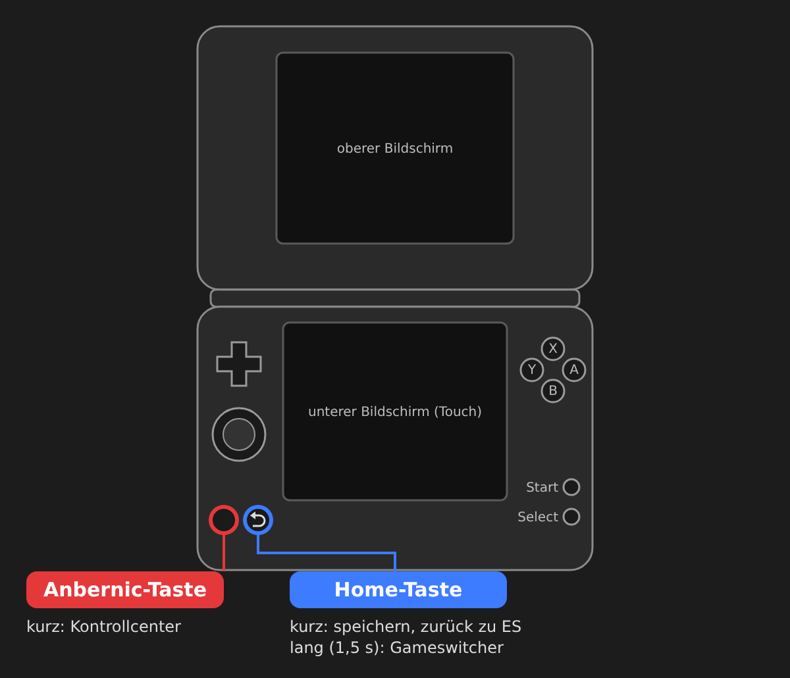
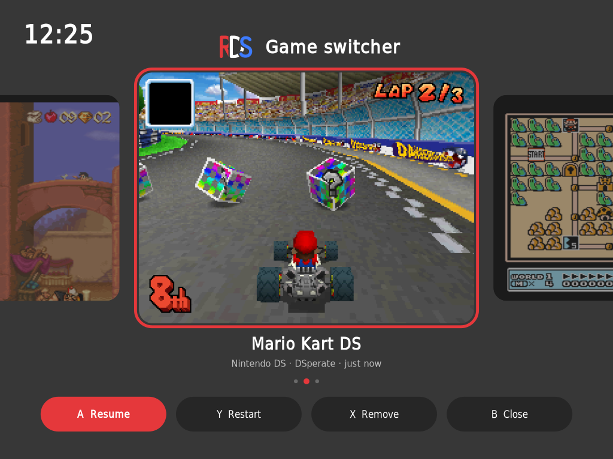
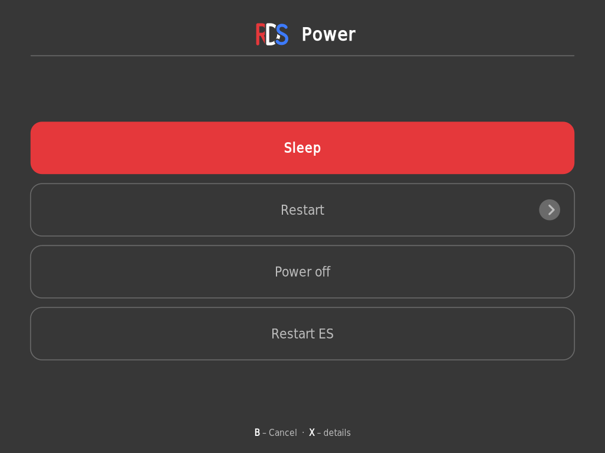
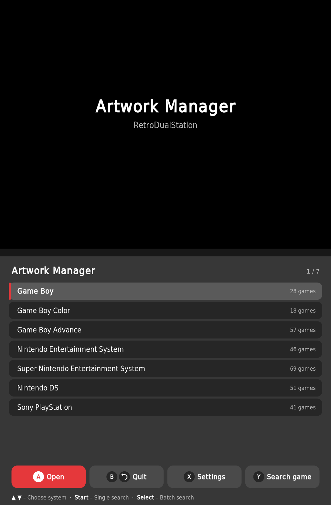
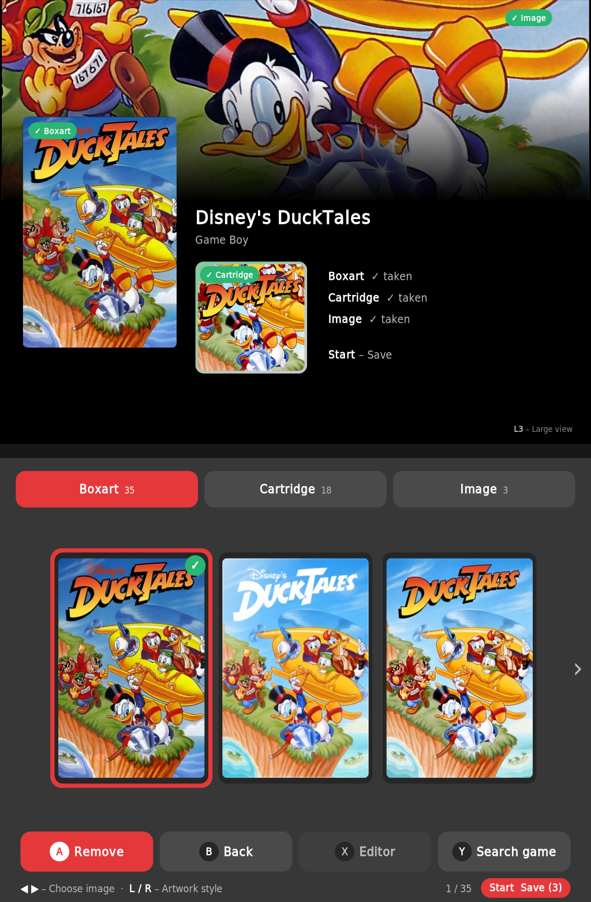
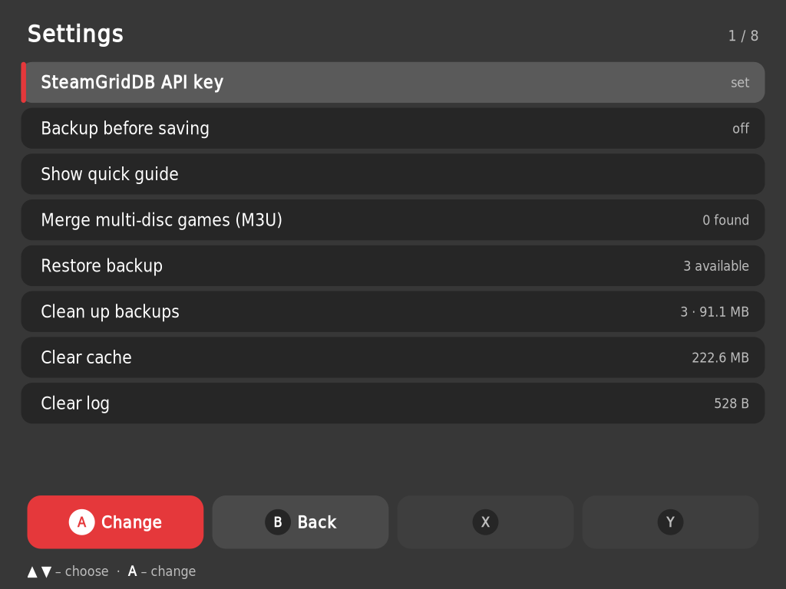

# RetroDualStation – Kurze Tour

*[English version](TOUR.md)*

RetroDualStation macht ROCKNIX auf dem Anbernic RG DS Plus zu **einem System mit zwei Bildschirmen**.
Diese Tour zeigt die Erweiterungen zu EmulationStation: die zwei Sondertasten, das Kontrollcenter,
den Gameswitcher, das Power-Menü und den Artwork Manager.

Dieselbe Tour läuft nach der Installation einmal auf dem Gerät. Du kannst sie jederzeit im
Kontrollcenter mit **Select** erneut starten.

---

## 1. Die zwei Sondertasten

| Taste | Drücken | Funktion |
|---|---|---|
| **Anbernic** | kurz | **Kontrollcenter** öffnen / schließen |
| **Home** | kurz | Im Spiel: **speichern** und zurück zu EmulationStation |
| **Home** | lang (1,5 s) | **Gameswitcher** öffnen |
| **Power** | kurz | **Power-Menü** öffnen |
| **Power** | lang (0,8 s) | Sofort **Ruhemodus** |

---

## 2. Kontrollcenter

Öffnen mit der **Anbernic**-Taste – in EmulationStation und in jedem Spiel (das Spiel pausiert).

- **Läuft gerade:** das laufende Spiel mit *Spiel beenden*.
- **Helligkeit** oben und unten sowie **Lautstärke** – mit dem Steuerkreuz oder per Touch.
- **Leistung:** Sparen · Ausgewogen · Leistung.
- **Kacheln:** WLAN und Bluetooth (**X / Y** – Details und Koppeln), *Unterer Screen aus*
  (mit der Anbernic-Taste wieder einschalten) und *Ruhemodus*.
- Oben rechts: Power-Menü, helles/dunkles Design und Akzentfarbe.

**L1 / R1** – Seite wechseln · **B** – Schließen · **Select** – diese Tour erneut starten

---

## 3. Gameswitcher

**Home** 1,5 Sekunden halten. Die zuletzt gespielten Spiele erscheinen als Karten mit ihrem letzten Bild.
Beim Wechseln wird das laufende Spiel automatisch gesichert und das nächste dort fortgesetzt,
wo du aufgehört hast.

**◀ ▶** – wählen · **A** – Weiterspielen · **Y** – Neu starten · **X** – Aus der Liste entfernen · **B** – Schließen

---

## 4. Power-Menü

**Power** kurz drücken: *Ruhemodus*, *Neu starten*, *Ausschalten* und *ES neu starten*.
Power gedrückt halten schickt das Gerät sofort in den Ruhemodus.

**▲ ▼** – wählen · **A** – bestätigen · **X** – Details · **B** – abbrechen

---

## 5. Artwork Manager

| | | |
|---|---|---|
|  |  |  |

Start über **Ports → Artwork Manager**. Er ergänzt **Boxart**, **Cartridge** (1:1-Icon) und
**Image** (Hero) – der obere Bildschirm zeigt, wie die drei zusammen wirken.

**Voraussetzung:** Jedes System braucht eine `gamelist.xml`. Sie entsteht einmalig mit dem Scraper
im Single-Screen-Modus (originale ROCKNIX-Oberfläche); RetroDualStation nutzt dieselbe Liste.

| Wo | Taste | Funktion |
|---|---|---|
| Systemliste | **Start** | Einzelsuche: ein Spiel bearbeiten |
| | **Select** | Mehrfachsuche: alle Spiele mit fehlenden Artworks nacheinander |
| | **Y** | Spiel über alle Systeme suchen |
| | **X** | Einstellungen (API-Key, Sicherungen, mehrteilige Spiele per M3U zusammenfassen, Zwischenspeicher, Kurzanleitung) |
| Spieleliste | **X** | Direkt in den Editor für dieses Spiel |
| | **Y** | Filter: alle · fehlende · keine Artworks |
| Spielansicht | **◀ ▶** | Bild wählen |
| | **L / R** | Artwork-Stil |
| | **A** | Bild übernehmen |
| | **Start** | Speichern |
| | **Y** | Anderes Spiel suchen |
| | **L3** | Mix-Ansicht / Großansicht oben |
| | **X** | Editor: aus dem gewählten Bild ein 1:1-Cartridge-Bild mit iiSU-Rahmen machen (◀ ▶ ▲ ▼ verschieben · L / R Zoom · Y Rahmen) |

Vor dem ersten Speichern pro System wird eine Sicherung angelegt (in den Einstellungen abschaltbar).
**Eigene Bilder:** PNG-, JPG- oder WebP-Dateien in `ports/artworkmanager/eigene/` (oder `eigene/<System>/`) legen und wie das Spiel benennen – sie erscheinen vorn in jedem Tab als *Eigenes Bild*. Alles in `eigene/alle/` erscheint bei jedem Spiel.

Den SteamGridDB-API-Key kannst du auch am PC eintragen:
`/storage/roms/ports/artworkmanager/settings.cfg`.

---

*Logos und Artworks in den Screenshots gehören ihren jeweiligen Rechteinhabern.*
