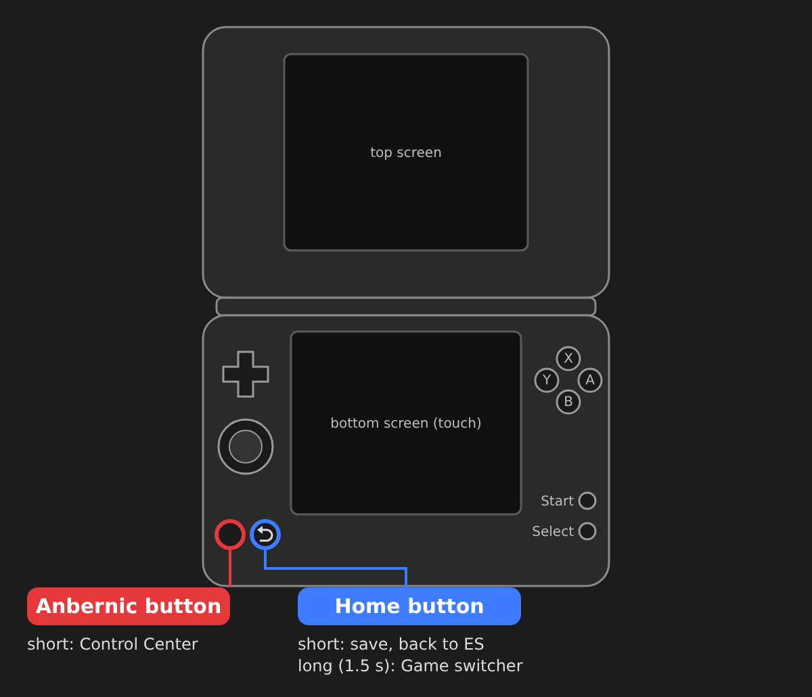

# RetroDualStation – Quick tour

*[Deutsche Fassung](TOUR.de.md)*

RetroDualStation turns ROCKNIX on the Anbernic RG DS Plus into **one system with two screens**.
This tour shows the additions on top of EmulationStation: the two special buttons, the
Control Center, the Game switcher, the Power menu and the Artwork Manager.

The same tour runs once on the device after installation. You can start it again at any time
from the Control Center with **Select**.

---

## 1. The two special buttons

| Button | Press | Action |
|---|---|---|
| **Anbernic** | short | Open / close the **Control Center** |
| **Home** | short | In a game: **save** and return to EmulationStation |
| **Home** | long (1.5 s) | Open the **Game switcher** |
| **Power** | short | Open the **Power menu** |
| **Power** | long (0.8 s) | **Sleep** immediately |

---

## 2. Control Center

Open it with the **Anbernic** button – in EmulationStation and in every game (the game pauses).

- **Now playing:** the running game with *Quit game*.
- **Brightness** of the top and bottom screen and **volume** – with the D-pad or by touch.
- **Performance:** Battery saver · Balanced · Performance.
- **Tiles:** Wi-Fi and Bluetooth (**X / Y** – details and pairing), *Bottom screen off*
  (wake it with the Anbernic button) and *Sleep*.
- Top right: power menu, light/dark theme and accent colour.

**L1 / R1** – switch page · **B** – close · **Select** – start this tour again

---

## 3. Game switcher

Hold **Home** for 1.5 seconds. Your recently played games appear as cards with their last screen.
Switching saves the running game automatically and continues the next one where you left off.

**◀ ▶** – choose · **A** – Resume · **Y** – Restart · **X** – Remove from list · **B** – Close

---

## 4. Power menu

Press **Power** briefly: *Sleep*, *Restart*, *Power off* and *Restart ES*.
Holding Power sends the device to sleep right away.

**▲ ▼** – choose · **A** – confirm · **X** – details · **B** – cancel

---

## 5. Artwork Manager

| | | |
|---|---|---|
|  |  |  |

Start it from **Ports → Artwork Manager**. It adds **Boxart**, **Cartridge** (1:1 icon) and
**Image** (hero) to your games – the top screen shows how the three look together.

**Requirement:** every system needs a `gamelist.xml`. Create it once with the scraper in
single-screen mode (original ROCKNIX interface); RetroDualStation uses the same list.

| Where | Button | Action |
|---|---|---|
| System list | **Start** | Single search: edit one game |
| | **Select** | Batch search: all games with missing artwork, one after another |
| | **Y** | Search a game across all systems |
| | **X** | Settings (API key, backups, merge multi-disc games as M3U, cache, quick guide) |
| Game list | **X** | Open the editor for this game directly |
| | **Y** | Filter: all · missing · no artwork |
| Game view | **◀ ▶** | Choose image |
| | **L / R** | Artwork style |
| | **A** | Take image |
| | **Start** | Save |
| | **Y** | Search another game |
| | **L3** | Mix view / large view on top |
| | **X** | Editor: turn the chosen image into a 1:1 cartridge image with iiSU border (◀ ▶ ▲ ▼ move · L / R zoom · Y border) |

Before the first save per system a backup is created (can be turned off in the settings).
**Own images:** put PNG/JPG/WebP files into `ports/artworkmanager/eigene/` (or `eigene/<system>/`), named like the game – they appear first in every tab marked *Own image*. Everything in `eigene/alle/` appears for every game.

The SteamGridDB API key can also be entered on a PC in
`/storage/roms/ports/artworkmanager/settings.cfg`.

---

*Logos and artwork in screenshots belong to their respective owners.*
