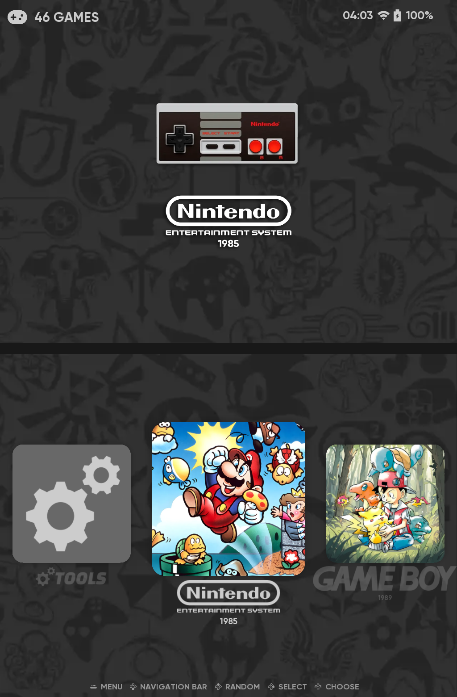
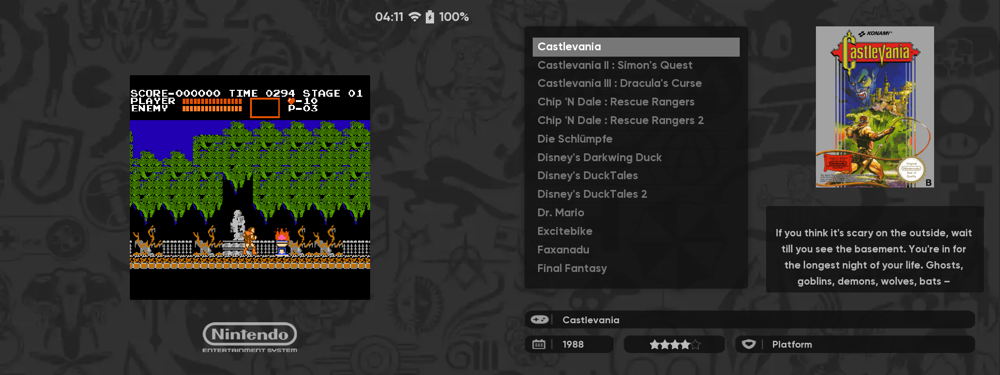

# canvas-ds – RG DS Plus overlay

RG DS Plus adaptation of **[canvas-ds](https://github.com/toniremi/canvas-ds)**
by **toniremi**, shared with his permission. This folder contains only the
changed layout files – the artwork, fonts and everything else come from the
original theme.

> 🇩🇪 Anpassung des Themes canvas-ds von toniremi an das RG DS Plus, mit seiner
> Erlaubnis veröffentlicht. Hier liegen nur die 7 geänderten Layout-Dateien;
> Grafiken und alles andere kommen aus dem Original-Theme.





## Changes from the original

| | Original (RG DS) | This overlay (RG DS Plus) |
|---|---|---|
| Canvas | 1920 × 480 (three 640 × 480 areas, the third unused) | 2048 × 768 (two 1024 × 768 screens) |
| Horizontal positions and widths | as designed | × 1.5 (`pos`, `size`, `maxSize`, `minSize`, `w`, `logoSize`, layout variables, x animations) |
| Vertical values, fonts | as designed | unchanged |
| Gamelist style "Automatic" | systems without scraped media fall back to ES's unstyled basic view | the icon carousel (`defaultView="gamecarousel"`); "Basic" is no longer offered |

Not scaled on purpose: item templates and grid tiles (relative to the tile)
and carousel logo sizes (ES multiplies them by the carousel size, which is
already scaled).

`tools/scale_canvas.py` is the script that produced these files from the
original; `tools/SCALED-VALUES.txt` lists every changed value.

## Game list views

The original game list layouts of canvas-ds are replaced by four views for
the two screens (`_inc/variants/variants.xml`). On the top screen all of them
show the hero artwork (`image`); a video fades in after 5 seconds.

| Gamelist view style | Bottom screen | Media |
|---|---|---|
| Detailed | large 2:3 cover on the left, title, description, players, year, developer on the right | `boxart` |
| Automatic / Carousel | 3 square icons, like the system view, name of the selected game below | `thumbnail` (the Artwork Manager points it to the icon) |
| Grid | canvas-ds game grid, without the metadata bars | `boxart` |
| Spotlight | one large card (2:3 cover left, logo right) that slides in from the side like the system view | `boxart` + `marquee` |
| Showcase | game names as a vertical carousel on the left, info card on the right (icon, genre, players, year, developer, rating, play time, last played) | `cartridge` / `thumbnail` |

## Requirements

The dual-screen ES from this repository (ES window 2048 × 768 across both
screens).

## Installation

### Easy way: installer via Ports

Requires ROCKNIX DualStation to be installed.

1. Download **`canvas-ds-rgds-plus-v8.zip`** from the
   [latest release](https://github.com/Ninte86hl/rocknix-dualstation/releases/latest)
   (about 180 MB – the complete theme including toniremi's artwork).
2. Unpack it into the **`ports`** folder of your ROMs.
3. Start **Ports → Install canvas-ds theme**. ES restarts and shows a
   message when it is done.
4. Select **canvas-ds-rgds-plus** under *User Interface Settings → Theme*.

The ZIP is built with `tools/make-canvas-installer.py`, which takes
canvas-ds from toniremi's repository and applies this overlay.
*Uninstall ROCKNIX DualStation* removes the theme as well.

### Manual installation

On your computer:

```bash
git clone --depth 1 https://github.com/toniremi/canvas-ds.git canvas-ds-rgds-plus
```
```bash
cp -r theme/canvas-ds-rgds-plus-overlay/_inc theme/canvas-ds-rgds-plus-overlay/*.xml canvas-ds-rgds-plus/
```
```bash
rm -rf canvas-ds-rgds-plus/.git
```
```bash
scp -r canvas-ds-rgds-plus root@<IP>:/storage/.config/emulationstation/themes/
```

Then select **canvas-ds-rgds-plus** under *User Interface Settings → Theme*.
The Ports switch remembers it for the dual-screen mode.

**Do not use the `scripts/` folder of canvas-ds** with this mod – it rewrites
the Sway config and the ES start script for the RG DS.

## Credits and license

- **toniremi** – [canvas-ds](https://github.com/toniremi/canvas-ds), the dual-screen
  adaptation this overlay is based on
- **Siddy212** – [Canvas (ES version)](https://github.com/Siddy212/canvas-es), the
  original theme
- **fagnerpc** – original artwork and layouts
- **Zoidburg13** – system icons
- **beebono** – [dii-ess-aye](https://github.com/beebono/dii-ess-aye), which
  inspired the dual-screen layout

License: **Creative Commons BY-NC-SA** as stated by canvas-ds and Canvas
(https://creativecommons.org/licenses/by-nc-sa/2.0/) – attribution,
non-commercial use only, adaptations under the same license. This overlay is
shared under the same terms. (The `LICENSE` file of canvas-ds says CC0, but
the theme derives from Canvas, so the BY-NC-SA terms are followed here.)
